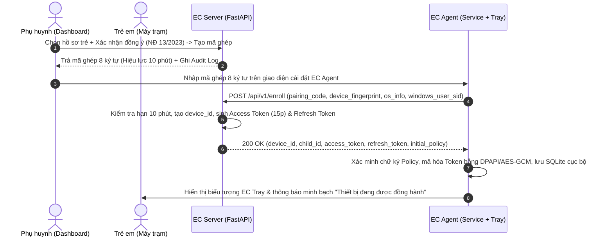
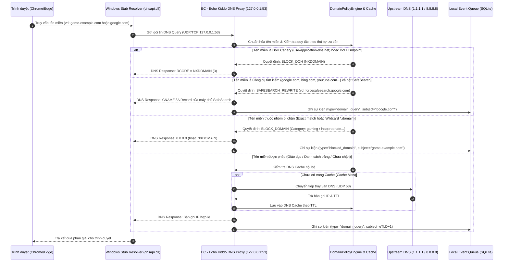
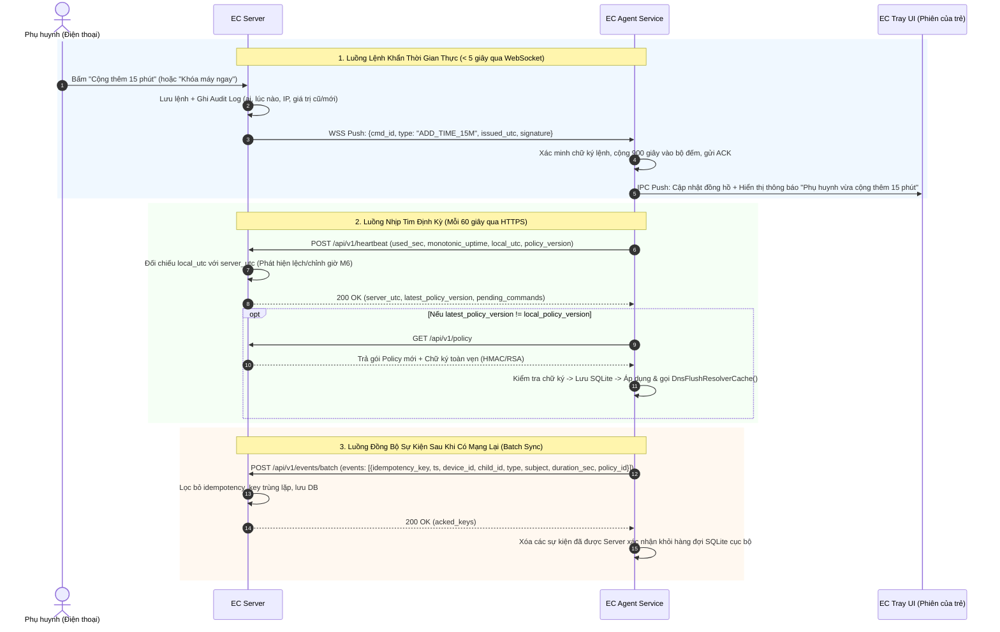
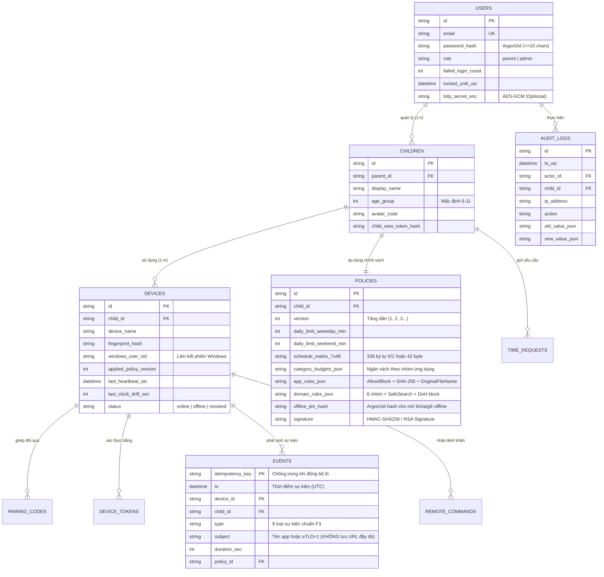

# Tài Liệu Kiến Trúc Hệ Thống (System Architecture Document)

> **Tài liệu thuộc bộ đặc tả kiến trúc dự án EC - Echo Kiddo**
> - [Kiến trúc hệ thống (architecture.md)](./architecture.md) *(Tài liệu hiện tại)*
> - [Đặc tả chức năng (functional-specification.md)](./functional-specification.md)
> - [Đặc tả kỹ thuật (technical-specification.md)](./technical-specification.md)
> - [Đối chiếu tính năng (feature-comparison.md)](./feature-comparison.md)
> - [Nhật ký thay đổi & Truy vết (architecture-change-log.md)](./architecture-change-log.md)

---

## Mục Lục

1. [Tổng Quan Dự Án (Project Overview)](#1-tổng-quan-dự-án-project-overview)
2. [Mục Tiêu Kiến Trúc (Architecture Goals)](#2-mục-tiêu-kiến-trúc-architecture-goals)
3. [Kiến Trúc Tổng Thể Hệ Thống (System Architecture)](#3-kiến-trúc-tổng-thể-hệ-thống-system-architecture)
4. [Kiến Trúc Phân Tầng (Architectural Layers)](#4-kiến-trúc-phân-tầng-architectural-layers)
5. [Kiến Trúc Mô-đun & Trách Nhiệm Thành Phần (Module & Component Architecture)](#5-kiến-trúc-mô-đun--trách-nhiệm-thành-phần-module--component-architecture)
6. [Luồng Xử Lý Dữ Liệu Chính (Data Flow)](#6-luồng-xử-lý-dữ-liệu-chính-data-flow)
7. [Kiến Trúc Tích Hợp & Giao Thức (Integration Architecture)](#7-kiến-trúc-tích-hợp--giao-thức-integration-architecture)
8. [Kiến Trúc Dữ Liệu Tổng Quan (Data Architecture Overview)](#8-kiến-trúc-dữ-liệu-tổng-quan-data-architecture-overview)
9. [Trải Nghiệm Người Dùng & Luồng Tương Tác (UX & Interaction Architecture)](#9-trải-nghiệm-người-dùng--luồng-tương-tác-ux--interaction-architecture)
10. [Ngăn Xếp Công Nghệ (Technology Stack)](#10-ngăn-xếp-công-nghệ-technology-stack)
11. [Kiến Trúc Bảo Mật, Quyền Riêng Tư & Xử Lý Lỗi (Security, Privacy & Error Handling)](#11-kiến-trúc-bảo-mật-quyền-riêng-tư--xử-lý-lỗi-security-privacy--error-handling)
12. [Ràng Buộc Kiến Trúc (Architectural Constraints)](#12-ràng-buộc-kiến-trúc-architectural-constraints)
13. [Các Quyết Định Thiết Kế Trọng Yếu (Architecture Decision Records - ADRs)](#13-các-quyết-định-thiết-kế-trọng-yếu-architecture-decision-records---adrs)

---

## 1. Tổng Quan Dự Án (Project Overview)

**EC - Echo Kiddo** là hệ thống hỗ trợ quản lý việc sử dụng máy tính của trẻ em trên nền tảng Windows 10/11 (x64), kết hợp với máy chủ quản trị tập trung và bảng điều khiển web dành cho phụ huynh và trẻ em.

- **Triết lý cốt lõi:** *"Công cụ đồng hành, không phải phần mềm theo dõi lén"* (Transparent Companion, Not Stalkerware).
- **Quy mô thực hiện:** Nhóm 03 sinh viên — Thời lượng 06 tuần (Đồ án môn học Mạng máy tính).
- **Nguồn gốc tổng hợp kiến trúc:**
  1. **Teacher Requirements (`DoAn01.docx`)**: Khung kiến trúc chuẩn Client-Server (`EC Agent` + `EC Server` + `Dashboard`), các yêu cầu bắt buộc F1–F5 và phụ lục kỹ thuật hệ thống – mạng M1–M6.
  2. **Current Project Baseline**: Ngăn xếp công nghệ đã được xác nhận (`Python 3.11+`, `FastAPI`, `SQLite`, `SQLAlchemy`, `Uvicorn`, `pywin32`, `psutil`).
  3. **Reference Application (`Safe Kids v5.1.27`)**: Chọn lọc các cơ chế kỹ thuật hệ thống có giá trị cao (khởi chạy tiến trình qua biên giới Session 0, giao thức IPC Named Pipe có xác thực SID & chống Timing Attack, nhận diện ứng dụng đa lớp SHA-256 + PE `OriginalFileName`, quản lý Snapshot cấu hình DNS/Registry trình duyệt và công cụ khôi phục sạch `Cleanup`) đồng thời loại bỏ hoàn toàn các tính năng xâm phạm quyền riêng tư (chụp màn hình lén, theo dõi URL đầy đủ/từ khóa tìm kiếm).

---

## 2. Mục Tiêu Kiến Trúc (Architecture Goals)

1. **Minh bạch và Tôn trọng Quyền riêng tư theo Thiết kế (Privacy & Transparency by Design)**:
   - Không có chế độ chạy ẩn (Stealth Mode). Nếu biểu tượng khay hệ thống (Tray UI) không thể hiển thị trên phiên của trẻ, Agent tự động dừng cưỡng chế.
   - Tối thiểu hóa dữ liệu tuyệt đối: chỉ thu thập đúng 7 trường trong lược đồ sự kiện chuẩn (`ts, device_id, child_id, type, subject, duration_sec, policy_id`), trong đó `subject` chỉ là tên ứng dụng hoặc tên miền cấp hai (eTLD+1), tuyệt đối không lưu URL đầy đủ, nội dung trang web, từ khóa tìm kiếm hay ảnh chụp màn hình.
   - Trẻ được xem cùng bộ dữ liệu hoạt động của mình ("Hôm nay em đã dùng gì") và được xem Nhật ký kiểm toán (Audit Log) mọi thay đổi chính sách của phụ huynh.
2. **Bảo vệ Đa lớp ở Tầng Hệ thống & Mạng (Defense-in-Depth)**:
   - Phân giải và lọc tên miền qua **DNS Proxy cục bộ tại `127.0.0.1:53`**, kết hợp cưỡng chế SafeSearch và vô hiệu hóa DNS-over-HTTPS (DoH) qua cả DNS Canary (`NXDOMAIN`), danh sách chặn DoH endpoint và Group Policy Registry của trình duyệt.
   - Kiểm soát tiến trình bằng mã băm **SHA-256** kết hợp thông tin PE Header (`OriginalFileName`), chống đổi tên tệp thực thi.
3. **Chịu lỗi và Tự phục hồi An toàn (Resilience & Clean Rollback)**:
   - Hoạt động độc lập khi mất kết nối mạng (Offline-first enforcement) với bộ nhớ đệm SQLite cục bộ và đồng bộ theo lô chống trùng lặp (`idempotency_key`).
   - Mọi can thiệp vào cấu hình mạng (DNS Card mạng) và Registry trình duyệt đều phải có **Snapshot gốc** để khôi phục sạch sẽ 100% khi dừng dịch vụ hoặc gỡ cài đặt (`ogk_cleanup`).
4. **Độ trễ Thời gian thực và Hiệu năng Nhẹ (Low Latency & Lightweight Footprint)**:
   - Phản hồi lệnh khẩn (khóa máy ngay, mở khóa, cộng thêm 15 phút) trong vòng **$< 5\text{ giây}$** qua WebSocket.
   - Đồng bộ chính sách định kỳ trong vòng **$\le 60\text{ giây}$** qua Heartbeat.
   - Độ trễ phân giải DNS qua Proxy nội bộ thấp (mục tiêu $p_{50} < 5\text{ ms}$ với cache hit) và mức tiêu thụ CPU của Agent lúc rảnh $< 2\%$, RAM $< 80\text{ MB}$.

---

## 3. Kiến Trúc Tổng Thể Hệ Thống (System Architecture)

Hệ thống EC - Echo Kiddo được thiết kế theo mô hình **Distributed Client-Service & Web Management Architecture** gồm hai nút vật lý/logic chính: **Máy của trẻ (`EC Agent` trên Windows 10/11)** và **Máy chủ quản trị (`EC Server` + `Web Dashboard` trên LAN/VPS Lab)**.

```mermaid
flowchart TB
    subgraph ChildPC["MÁY CỦA TRẺ (Windows 10/11 x64)"]
        direction TB
        subgraph UserSession["Phiên Người Dùng (Standard User - Session 1+)"]
            Browser["Trình duyệt Web<br/>(Chrome / Edge / Firefox / Cốc Cốc)"]
            ChildApps["Ứng dụng & Trò chơi<br/>(Desktop Apps)"]
            TrayUI["EC Tray UI (Python GUI)<br/>- Đồng hồ thời gian còn lại<br/>- Cửa sổ cảnh báo 10/5/1p & Ân hạn 60s<br/>- Nút 'Xin thêm giờ' / Nhập PIN phụ huynh<br/>- Màn hình 'Hôm nay em đã dùng gì'"]
        end

        subgraph SystemSession["Phiên Hệ Thống (NT AUTHORITY\\SYSTEM - Session 0)"]
            subgraph OGKService["EC Agent Windows Service"]
                Lifecycle["Protection Lifecycle &<br/>Session Agent Launcher (WTS API)"]
                PolicyEnforcer["Policy Verifier & Enforcer<br/>(HMAC/RSA Verification)"]
                ScreenTimer["Screen-Time Counter<br/>(Monotonic Clock + Idle Detector)"]
                AppCtrl["App Controller<br/>(SHA-256 + PE OriginalFileName)"]
                DnsProxy["Local DNS Proxy (127.0.0.1:53)<br/>(6 Categories + SafeSearch + DoH Block)"]
                BypassGuard["Anti-Bypass & Platform Guard<br/>(DNS Lock + Browser Policy Snapshot)"]
                SyncClient["Sync & Realtime Client<br/>(HTTPS Pinned + WebSocket + Offline Queue)"]
            end
            LocalDB[("Local SQLite Cache<br/>(ProgramData\\OGK\\agent.db)<br/>ACL: SYSTEM/Admins Only")]
            CleanupCLI["OGK-Cleanup Utility<br/>(Khôi phục DNS & Registry từ Snapshot)"]
        end
    end

    subgraph ServerNode["MÁY CHỦ QUẢN TRỊ (LAN hoặc VPS Lab)"]
        direction TB
        subgraph FastAPIServer["EC Server (FastAPI + Uvicorn + TLS 1.2+)"]
            AuthMod["Auth & Session Module<br/>(Argon2id, CSRF, Rate Limit, RBAC)"]
            EnrollMod["Enrollment & Device Token Module<br/>(Mã ghép 8 ký tự, JWT/Refresh Token)"]
            PolicyMod["Policy & Classification Engine<br/>(Versioned Policy + HMAC/RSA Signer)"]
            CommandMod["Realtime Command Hub<br/>(WebSocket Manager < 5s)"]
            EventMod["Event Ingestion & Privacy Purge<br/>(Idempotent Batch + 90d Retention)"]
            ReportAuditMod["Reporting & Audit Log Module<br/>(Charts, CSV/PDF, NT5 Audit Trail)"]
        end
        ServerDB[("Server SQLite Database (WAL)<br/>(SQLAlchemy + AES-GCM Sensitive Fields)")]
        WebDash["Web Dashboard (Jinja2 + HTMX)<br/>- Giao diện Phụ huynh (Mobile-ready)<br/>- Giao diện Minh bạch cho Trẻ"]
    end

    UpstreamDNS["Upstream DNS Resolver<br/>(1.1.1.1 / 8.8.8.8 / ISP)"]

    Browser -->|"DNS Query (UDP/TCP 53)"| DnsProxy
    DnsProxy -->|"Forward Allowed Queries"| UpstreamDNS
    AppCtrl -.->|"Quét SHA-256 / TerminateProcess"| ChildApps
    Lifecycle -->|"WTS CreateProcessAsUser<br/>& Named Pipe IPC (IpcEnvelope)"| TrayUI
    OGKService <-->|"Đọc/Ghi Chính sách, Sự kiện & Snapshot"| LocalDB
    CleanupCLI -->|"Đọc Snapshot & Hoàn nguyên"| LocalDB
    SyncClient <-->|"HTTPS TLS 1.2+ (Cert Pinning)<br/>Heartbeat 60s / Policy / Events"| FastAPIServer
    SyncClient <-->|"WSS (WebSocket)<br/>Lệnh khẩn < 5s"| CommandMod
    FastAPIServer <--> ServerDB
    WebDash <-->|"HTTPS (Cookie HttpOnly + CSRF)"| FastAPIServer
```

---

## 4. Kiến Trúc Phân Tầng (Architectural Layers)

Hệ thống được phân chia thành **5 tầng kiến trúc (Layers)** rõ ràng với nguyên tắc phụ thuộc một chiều từ trên xuống dưới:

| Tầng (Layer) | Tại `EC Agent` (Máy của trẻ) | Tại `EC Server` & `Dashboard` (Máy chủ) |
|---|---|---|
| **1. Presentation & Transparency Layer (Tầng Giao diện & Minh bạch)** | `EC Tray UI`: Biểu tượng khay hệ thống, đồng hồ đếm ngược, hộp thoại cảnh báo 10/5/1 phút & ân hạn 60 giây, hộp thoại giải thích lýقف chặn ứng dụng, nút "Xin thêm giờ", màn hình "Hôm nay em đã dùng gì". | `Web Dashboard` (Jinja2 + HTMX + Chart.js): Giao diện quản trị phụ huynh (tương thích di động) và Cổng thông tin minh bạch cho trẻ (xem thống kê và nhật ký kiểm toán NT5). |
| **2. Communication & Transport Layer (Tầng Giao tiếp & Truyền vận)** | - **External**: `HTTPS Client` (ghim chứng chỉ `Certificate Pinning`) + `WebSocket Client` (tự động kết nối lại với Exponential Backoff). - **Internal IPC**: `Named Pipe Server/Client` sử dụng `IpcEnvelope` có xác thực `CallerSid` và `ChallengeToken`. | - `FastAPI Routers` (`/auth`, `/enroll`, `/heartbeat`, `/policy`, `/events`, `/commands`, `/reports`, `/audit`). - `WebSocket Hub` đẩy lệnh khẩn thời gian thực. - Middleware: TLS 1.2+, Rate Limiter, CSRF Protection, RBAC Guard. |
| **3. Core Domain & Policy Layer (Tầng Nghiệp vụ & Chính sách)** | - `PolicyVerifier`: Xác minh chữ ký HMAC/RSA của chính sách. - `ScreenTimeEngine`: Đếm giờ thực, kiểm tra ma trận $7 \times 48$, kiểm tra quota nhóm ứng dụng, chống chỉnh giờ. - `DomainPolicyEngine`: Đối chiếu tên miền chính xác & tên miền con (`*.domain`), phân loại 6 nhóm, luật SafeSearch & DoH Canary. | - `EnrollmentService`: Sinh mã 8 ký tự (10 phút), cấp cặp Access/Refresh Token. - `PolicyCompiler & Signer`: Biên dịch quy tắc của phụ huynh thành gói chính sách có số phiên bản (`policy_version`) và ký toàn vẹn. - `EventAggregator & RetentionWorker`: Tổng hợp báo cáo, khử trùng lặp sự kiện và xóa dữ liệu quá 90 ngày. |
| **4. OS Platform & Network Enforcement Layer (Tầng Cưỡng chế Hệ điều hành & Mạng)** | *(Kế thừa tinh hoa từ `SafeKids.Platform.dll`)*: - `DnsProxyServer`: Lắng nghe `127.0.0.1:53` (UDP/TCP). - `ProcessEnforcer`: Quét tiến trình, tính SHA-256 + đọc PE `OriginalFileName`, đóng tiến trình vi phạm. - `NetworkDnsGuard`: Chụp snapshot & khóa DNS card mạng về `127.0.0.1`, gọi `DnsFlushResolverCache`. - `BrowserPolicyGuard`: Chụp snapshot & áp Registry tắt DoH trên trình duyệt. - `SessionLauncher`: Quản lý tiến trình `EC Tray` qua WTS API. | *(Không áp dụng — Server độc lập nền tảng, chạy trên Windows hoặc Linux container).* |
| **5. Persistence & Crypto Layer (Tầng Lưu trữ & Mật mã)** | - `Local SQLite Store` (`C:\ProgramData\OGK\agent.db`): Lưu chính sách đã ký, hàng đợi sự kiện offline (`event_queue`), bộ đếm ngày (`daily_usage`), và bản chụp hệ thống (`system_snapshots`). - `DPAPI / AES-GCM Store`: Bảo vệ token thiết bị và khóa xác thực cục bộ. | - `Server SQLite Database` (chế độ `WAL`) qua `SQLAlchemy ORM`. - `CryptoProvider`: Băm mật khẩu `Argon2id`, mã hóa trường nhạy cảm `AES-256-GCM` (khóa từ biến môi trường/DPAPI). |

---

## 5. Kiến Trúc Mô-đun & Trách Nhiệm Thành Phần (Module & Component Architecture)

### 5.1. Phân hệ Máy Trạm: `EC Agent` (`/agent`)

| Mô-đun | Đường dẫn dự kiến | Trách nhiệm chính | Nguồn gốc / Tham chiếu |
|---|---|---|---|
| **Service Host & Lifecycle** | `/agent/service/win_service.py` | Đăng ký và chạy Windows Service dưới quyền `LocalSystem` (`win32serviceutil`); cấu hình SCM Service Recovery tự khởi động lại nếu bị crash/kill; điều phối các worker thread; tự dừng cưỡng chế nếu `Tray UI` không thể hiển thị (tuân thủ chống lạm dụng F5). | `DoAn01.docx` (4.2, F5, M5) + `REF-01` |
| **Session Agent Launcher** | `/agent/service/session_launcher.py` | Sử dụng WTS API (`WTSEnumerateSessions`, `WTSQueryUserToken`, `CreateProcessAsUser`) để khởi chạy và giám sát `EC Tray` trong phiên đăng nhập của trẻ; nhận diện `WindowsUserSid` để phân biệt phiên của trẻ và phiên Administrator của phụ huynh. | `REF-01`, `REF-15` (Adapted) |
| **IPC Server & Authorizer** | `/agent/ipc/pipe_protocol.py` | Truyền thông liên tiến trình giữa `Service` và `Tray UI` / `Cleanup CLI` qua Named Pipe `\\.\pipe\OGKServicePipe` (hoặc loopback `127.0.0.1` có token); đóng gói `IpcEnvelope`, kiểm tra `CallerSid` và xác thực `ChallengeToken` bằng `hmac.compare_digest`. | `DoAn01.docx` (4.2) + `REF-02` |
| **Time & Schedule Engine** | `/agent/core/screen_time.py` | Đếm thời gian sử dụng thực bằng `time.monotonic()`; tạm dừng đếm khi màn hình khóa (`WTS_SESSION_LOCK`) hoặc không có thao tác chuột/bàn phím quá 5 phút (`GetLastInputInfo`); kiểm tra hạn mức ngày thường/cuối tuần, ma trận lịch tuần $7 \times 48$, và ngân sách theo nhóm ứng dụng; phát hiện gian lận chỉnh đồng hồ hệ thống. | `DoAn01.docx` (F1, M6) + `REF-05`, `REF-13` |
| **App Controller** | `/agent/core/app_controller.py` | Quét tiến trình định kỳ (chu kỳ 2 giây), trích xuất đường dẫn tệp thực thi, tính mã băm SHA-256 (có LRU cache) và đọc `OriginalFileName` từ PE VersionInfo; kết thúc tiến trình bị chặn hoặc hết giờ nhóm ứng dụng và gửi tín hiệu cho `Tray UI` hiển thị hộp thoại giải thích lý do. | `DoAn01.docx` (F2) + `REF-03` |
| **Local DNS Proxy** | `/agent/dns/dns_proxy.py` | Lắng nghe trên `127.0.0.1:53` (UDP & TCP); đối chiếu tên miền truy vấn với cơ sở dữ liệu phân loại 6 nhóm (hỗ trợ khớp chính xác và wildcard tên miền con `*.domain`); trả `0.0.0.0` / `NXDOMAIN` cho tên miền bị chặn; ánh xạ CNAME/IP cưỡng chế SafeSearch (Google, Bing, YouTube, DuckDuckGo); trả `NXDOMAIN` cho DoH Canary (`use-application-dns.net`); chuyển tiếp truy vấn hợp lệ lên Upstream DNS kèm bộ nhớ đệm TTL. | `DoAn01.docx` (4.2, F2, M1) + `REF-07` |
| **Platform & Anti-Bypass Guard** | `/agent/platform/system_guard.py` | Chụp snapshot cấu hình DNS card mạng và trỏ DNS về `127.0.0.1`; tự động ép lại nếu trẻ đổi DNS thủ công sang `8.8.8.8`; chụp snapshot Registry trình duyệt và cấu hình tắt DoH (`DnsOverHttpsMode=off`); gọi `DnsFlushResolverCache()` khi đổi chính sách; phát hiện VPN Adapter / System Proxy. | `DoAn01.docx` (F2, M3) + `REF-08`, `REF-09`, `REF-10` |
| **Sync & WebSocket Client** | `/agent/sync/server_client.py` | Thực hiện ghép đôi thiết bị (Enrollment); gửi Heartbeat mỗi 60 giây; tải và kiểm tra chữ ký HMAC/RSA của chính sách (`PolicyVerifier`); duy trì kết nối WebSocket nhận lệnh khẩn ($<5\text{s}$); đẩy sự kiện từ hàng đợi SQLite lên Server theo lô kèm `idempotency_key`. | `DoAn01.docx` (4.3, F4, F5) + `REF-06` |
| **Tray UI & Child Transparency** | `/agent/ui/tray_app.py` | Hiển thị biểu tượng khay hệ thống và đồng hồ thời gian còn lại; hiển thị cửa sổ cảnh báo mốc 10, 5, 1 phút và đếm ngược 60 giây ân hạn lưu bài; hiển thị thông báo khi chặn ứng dụng; cho phép trẻ bấm "Xin thêm giờ" (gửi lên Server) hoặc phụ huynh nhập mã PIN/mật khẩu tại chỗ; mở màn hình "Hôm nay em đã dùng gì" và nhắc nghỉ mắt 20-20-20. | `DoAn01.docx` (4.2, F1, F2, F3) + `REF-04` |
| **Clean Recovery & Uninstaller** | `/agent/cleanup/ogk_cleanup.py` | Xác thực mật khẩu phụ huynh (online hoặc qua hash Argon2id lưu cục bộ), ghi sự kiện gỡ cài đặt, đọc bảng `system_snapshots` để hoàn trả nguyên trạng cấu hình DNS card mạng (DHCP/Static), xóa Registry Policies của trình duyệt, flush DNS cache và gỡ Windows Service sạch sẽ. | `DoAn01.docx` (F4, README) + `REF-11` |

### 5.2. Phân hệ Máy Chủ & Giao Diện Web: `EC Server` (`/server`) & `Dashboard` (`/dashboard`)

| Mô-đun | Đường dẫn dự kiến | Trách nhiệm chính | Nguồn gốc / Tham chiếu |
|---|---|---|---|
| **Auth & Security Middleware** | `/server/auth/` | Đăng ký/đăng nhập phụ huynh với mật khẩu băm `Argon2id` ($\ge 10$ ký tự); khóa tạm 15 phút sau 5 lần nhập sai; giới hạn tần suất (Rate Limit) theo IP; quản lý phiên bằng Cookie `HttpOnly, Secure, SameSite=Lax` (hạn 12 giờ) + CSRF Token; kiểm tra phân quyền 3 vai trò (`parent`, `child-view`, `admin`) và chống lỗi IDOR ở tầng truy vấn SQLAlchemy. | `DoAn01.docx` (F5) + `REF-14` |
| **Device Enrollment & Token Service** | `/server/services/enrollment.py` | Phụ huynh tạo mã ghép đôi 8 ký tự (hiệu lực 10 phút) gắn với hồ sơ trẻ (`child_id`) và ghi nhận sự đồng ý của phụ huynh (Nghị định 13/2023); xác thực yêu cầu ghép đôi kèm `device_fingerprint` từ Agent; cấp `device_id`, `access_token` (15 phút) và `refresh_token` dài hạn; thu hồi token khi gỡ thiết bị. | `DoAn01.docx` (4.3, F4, F5) |
| **Policy & Classification Service** | `/server/services/policy_service.py` | Quản lý mô hình `1 phụ huynh : n trẻ : m thiết bị`; lưu trữ cấu hình hạn mức ngày, ma trận lịch tuần $7 \times 48$, danh sách ứng dụng (SHA-256), và danh mục phân loại tên miền 6 nhóm ($\ge 200$ mục mặc định cho trẻ 6–11 tuổi); tăng `policy_version` và ký toàn vẹn (`HMAC-SHA256` / `RSA`) mỗi khi phụ huynh cập nhật; ghi Audit Log. | `DoAn01.docx` (F1, F2, F4) + `REF-06` |
| **Realtime Command & Heartbeat Hub** | `/server/services/command_hub.py` | Xử lý nhịp tim (Heartbeat) 60 giây từ Agent (đối chiếu `policy_version`, kiểm tra độ lệch thời gian `clock_drift`, trả danh sách lệnh chờ); quản lý kết nối WebSocket để đẩy tức thời ($< 5\text{s}$) các lệnh khẩn: `LOCK_NOW`, `UNLOCK`, `ADD_TIME_15M`, `PARENT_PAUSE_2H`, `PURGE_DATA`, `POLICY_UPDATED`. | `DoAn01.docx` (4.3, F4, M6) + `REF-12` |
| **Event Ingestion & Privacy Manager** | `/server/services/event_service.py` | Tiếp nhận lô sự kiện từ Agent với kiểm tra nghiêm ngặt lược đồ 7 trường (`ts, device_id, child_id, type, subject, duration_sec, policy_id`) và khử trùng lặp qua `idempotency_key`; chạy tác vụ nền tự động xóa dữ liệu quá 90 ngày; thực thi nút **"Xóa toàn bộ dữ liệu của con tôi"** trên cả Server lẫn Agent. | `DoAn01.docx` (4.3, F3) |
| **Reporting & Audit Service** | `/server/services/report_service.py` | Tổng hợp dữ liệu thời lượng theo ngày/tuần, Top 10 ứng dụng, Top 10 tên miền cấp hai, số lần bị chặn, danh sách yêu cầu xin thêm giờ của trẻ; xuất báo cáo tuần ra CSV/PDF; truy xuất Nhật ký kiểm toán (Audit Log: ai, lúc nào, IP nào, giá trị cũ/mới) cho cả phụ huynh và trẻ xem (nguyên tắc NT5). | `DoAn01.docx` (F3, F4) |
| **Parent & Child Web Dashboard** | `/dashboard/` | Giao diện web (Jinja2 + HTMX + CSS responsive cho điện thoại) gồm 2 chế độ hiển thị: (1) **Dashboard Phụ huynh**: quản lý trẻ/thiết bị, cấu hình lịch $7 \times 48$, quota, ứng dụng/web, duyệt yêu cầu, xem biểu đồ, xóa dữ liệu; (2) **Màn hình Minh bạch cho Trẻ ("Hôm nay em đã dùng gì")**: ngôn ngữ thân thiện, hình minh họa trực quan, xem lịch sử thay đổi chính sách. | `DoAn01.docx` (4.2, F3, F4) |

---

## 6. Luồng Xử Lý Dữ Liệu Chính (Data Flow)

### 6.1. Luồng Ghép Đôi Thiết Bị (Enrollment) & Ghi Nhận Sự Đồng Ý (Mục 4.3)

### 6.2. Luồng Phân Giải & Lọc Tên Miền Qua DNS Proxy Cục Bộ (Mục F2, M1)

### 6.3. Luồng Đồng Bộ Nhịp Tim (60s), Lệnh Khẩn WebSocket ($<5\text{s}$) & Chế Độ Ngoại Tuyến (Mục 4.3, F1, F4)

---

## 7. Kiến Trúc Tích Hợp & Giao Thức (Integration Architecture)

1. **Giao tiếp `EC Agent` $\leftrightarrow$ `EC Server` (Mạng LAN / Internet)**:
   - **REST API qua HTTPS (TLS 1.2+)**: Sử dụng thư viện `httpx` với cơ chế **Certificate Pinning** (ghim mã băm SHA-256 của chứng chỉ CA/Server vào cấu hình bảo vệ của Agent). Nếu chứng chỉ máy chủ không khớp (ví dụ trẻ dùng công cụ MITM như Fiddler/Charles/mitmproxy để giả mạo Server trả về quota vô hạn), Agent lập tức từ chối kết nối và giữ nguyên chính sách cục bộ.
   - **WebSocket qua WSS (`/ws/agent/{device_id}`)**: Kênh truyền hai chiều duy trì liên tục kèm Ping/Pong mỗi 20 giây để nhận lệnh khẩn trong vòng $< 5\text{ giây}$. Nếu WebSocket đứt kết nối, Agent tự động kết nối lại (Exponential Backoff: $1\text{s}, 2\text{s}, 4\text{s}, \dots, \text{tối đa } 30\text{s}$) và nhận lệnh chờ qua nhịp tim 60 giây.
2. **Giao tiếp `EC Service` (Session 0) $\leftrightarrow$ `EC Tray UI` (Session 1+)**:
   - Sử dụng **Windows Named Pipe** (`\\.\pipe\OGKServicePipe`) hoặc Localhost Socket với giao thức đóng gói **`IpcEnvelope`** (kế thừa từ `SafeKids.Core.Ipc`):
     - Mọi bản tin đều chứa `protocol_version`, `request_id`, `type`, `timestamp_utc`, `caller_sid`, `challenge_token` và `payload`.
     - `EC Service` lấy Windows SID thực sự của tiến trình đầu bên kia đường ống (`GetNamedPipeClientProcessId` / `OpenProcessToken`) để chống giả mạo.
     - Các thao tác quản trị cục bộ (như xác nhận mật khẩu phụ huynh để gỡ cài đặt hoặc mở khóa khi mất mạng) sử dụng cơ chế **Challenge-Response** một lần (TTL 30 giây) và đối chiếu bằng `hmac.compare_digest` chống tấn công Timing Attack.

---

## 8. Kiến Trúc Dữ Liệu Tổng Quan (Data Architecture Overview)

Kiến trúc dữ liệu tuân thủ nghiêm ngặt nguyên tắc **Tối thiểu hóa dữ liệu (Data Minimization)** ở mục F3 và mô hình phân cấp **`1 Phụ huynh : n Trẻ : m Thiết bị`** ở mục F4:

> [!IMPORTANT]
> **Ràng buộc Lược đồ Sự kiện (Strict Event Schema - Mục F3)**: Bảng `EVENTS` chỉ chứa đúng 7 trường nghiệp vụ (`ts`, `device_id`, `child_id`, `type`, `subject`, `duration_sec`, `policy_id`) cùng khóa chống trùng `idempotency_key` (theo mục 4.3). Trường `type` chỉ nhận 1 trong 9 giá trị: `app_start`, `app_stop`, `domain_query`, `blocked_app`, `blocked_domain`, `quota_warning`, `locked`, `unlock_request`, `override_granted`.

---

## 9. Trải Nghiệm Người Dùng & Luồng Tương Tác (UX & Interaction Architecture)

1. **Hành trình của Trẻ em (Child Journey — Minh bạch & Nhân văn)**:
   - **Trạng thái Bình thường (`NORMAL_ACTIVE`)**: Biểu tượng `EC Tray` luôn hiển thị ở khay hệ thống. Khi trẻ nhấp vào biểu tượng, cửa sổ nhỏ hiển thị số phút còn lại trong ngày, khung giờ được phép tiếp theo, nút **"Xin thêm giờ"** và nút **"Hôm nay em đã dùng gì"**.
   - **Trạng thái Cảnh báo Sắp hết giờ (`QUOTA_WARNING`)**: Lần lượt tại các mốc **10 phút, 5 phút và 1 phút** trước khi hết hạn mức ngày (hoặc trước khi đến khung giờ khóa trong ma trận $7 \times 48$), `EC Tray` hiển thị thông báo nổi không chiếm quyền điều khiển bàn phím để trẻ chủ động biết.
   - **Trạng thái Ân hạn 60 giây (`GRACE_PERIOD_60S` — Kế thừa và cải tiến từ `ViolationCountdownWindow`)**: Khi thời gian về 0, thay vì khóa máy đột ngột làm mất bài tập đang gõ dở, hệ thống bật cửa sổ đếm ngược **60 giây ân hạn** với thông điệp thân thiện: *"Đã hết giờ sử dụng máy hôm nay. Em còn 60 giây để lưu lại bài học hoặc gửi lời nhắn xin phép bố mẹ nhé!"* kèm nút **"Xin thêm giờ"** và **"Em đã lưu xong, khóa máy ngay"**.
   - **Trạng thái Chặn Ứng dụng (`APP_BLOCKED_NOTICE`)**: Khi trẻ mở một ứng dụng nằm trong danh sách chặn hoặc đã hết ngân sách thời gian của nhóm Trò chơi, tiến trình bị đóng và `EC Tray` hiển thị cửa sổ giải thích rõ lý do (ví dụ: *"Ứng dụng Game.exe (tên gốc: GenshinImpact.exe) tạm dừng vì thuộc danh mục Trò chơi đã hết 45 phút hôm nay"*), tuyệt đối không tắt im lặng (F2).
   - **Trạng thái Màn hình Khóa Phiên (`LOCKED_OVERLAY` / `LockWorkStation`)**: Khi hết 60 giây ân hạn, hệ thống hiển thị màn hình khóa của EC - Echo Kiddo (cho phép bấm "Xin thêm giờ" hoặc nhập mã mở khóa phụ huynh) và/hoặc khóa phiên làm việc. Khi phụ huynh bấm duyệt trên điện thoại, màn hình tự động mở khóa trong vòng $< 5\text{ giây}$.
2. **Hành trình của Phụ huynh (Parent Journey — Điều khiển mọi nơi)**:
   - Truy cập Web Dashboard trên điện thoại hoặc máy tính $\rightarrow$ Xem biểu đồ trực quan $\rightarrow$ Nhận thông báo khi trẻ bấm "Xin thêm giờ" $\rightarrow$ Chạm 1 nút để cộng thêm 15 phút hoặc điều chỉnh ma trận lịch tuần $7 \times 48$.

---

## 10. Ngăn Xếp Công Nghệ (Technology Stack)

Ngăn xếp công nghệ tuân thủ 100% quyết định đã xác nhận trong `DoAn01.docx`, không phát sinh công nghệ ngoại lai:

| Thành phần | Công nghệ / Thư viện chuẩn | Vai trò trong kiến trúc |
|---|---|---|
| **Ngôn ngữ chính** | **Python 3.11+ (x64)** | Ngôn ngữ thống nhất cho cả `EC Agent` và `EC Server`. |
| **Backend Server** | **FastAPI + Uvicorn (ASGI)** | Cung cấp REST API, WebSocket thời gian thực và phục vụ giao diện Web Dashboard qua TLS 1.2+. |
| **Cơ sở dữ liệu & ORM** | **SQLite 3 (WAL mode) + SQLAlchemy 2.0** | Lưu trữ dữ liệu trên Server (`server.db`) và bộ nhớ đệm/hàng đợi sự kiện/snapshot trên Agent (`agent.db`). |
| **Tương tác Hệ điều hành Windows** | **`pywin32` (`win32serviceutil`, `win32ts`, `win32pipe`, `win32security`, `win32api`) + `psutil` + `winreg` + `ctypes`** | Quản lý Windows Service (`LocalSystem`), khởi chạy Tray UI qua Session 0 Isolation, giao tiếp Named Pipe, quét tiến trình, đọc PE Header, cấu hình Registry và gọi `dnsapi.dll`. |
| **Xử lý DNS Proxy** | **`dnslib` + Python `asyncio` (UDP/TCP DatagramProtocol)** | Phân tích và đóng gói bản tin DNS chuẩn RFC 1035 tại `127.0.0.1:53` với hiệu năng bất đồng bộ cao. |
| **Bảo mật & Mật mã** | **`passlib[argon2]`, `cryptography` (AES-GCM, HMAC-SHA256, RSA/Ed25519, X.509)** | Băm mật khẩu phụ huynh Argon2id, mã hóa trường nhạy cảm AES-GCM, ký và xác minh chính sách, tạo chứng chỉ TLS cho phòng lab. |
| **Giao diện Web (Dashboard)** | **Jinja2 + HTMX + TailwindCSS / Bootstrap nhẹ + Chart.js** | Hiển thị Dashboard phụ huynh và màn hình minh bạch cho trẻ, phản hồi mượt trên trình duyệt điện thoại mà không cần chuỗi build SPA nặng nề. |
| **Giao diện Máy trạm (Tray UI)** | **`tkinter` / `CustomTkinter` + `pystray`** | Hiển thị biểu tượng khay hệ thống, đồng hồ đếm ngược, hộp thoại cảnh báo 60 giây và màn hình minh bạch cục bộ với mức tiêu thụ RAM tối thiểu ($< 25\text{ MB}$). |
| **Kiểm thử (Testing)** | **`pytest` + `pytest-asyncio` + `httpx`** | Thực thi bộ $\ge 15$ unit test và $\ge 5$ kịch bản kiểm thử tích hợp tự động. |

---

## 11. Kiến Trúc Bảo Mật, Quyền Riêng Tư & Xử Lý Lỗi (Security, Privacy & Error Handling)

### 11.1. Các Lớp Bảo Vệ Bảo Mật (Theo chuẩn F5 & ASVS)
1. **Xác thực & Phiên làm việc**: Mật khẩu phụ huynh tối thiểu 10 ký tự, băm bằng **Argon2id**; khóa tài khoản tạm thời 15 phút sau 5 lần đăng nhập sai; giới hạn tần suất theo IP (Rate Limiting); Cookie phiên bật `HttpOnly`, `Secure`, `SameSite=Lax` (hạn 12 giờ), hủy phiên phía Server khi đăng xuất, kiểm tra CSRF Token cho mọi truy vấn `POST/PUT/DELETE`.
2. **Bảo vệ Kênh truyền & Chống MITM**: Bắt buộc HTTPS/WSS (TLS 1.2+). `EC Agent` thực hiện **Certificate Pinning** (so khớp dấu vân tay SHA-256 của chứng chỉ Server/CA).
3. **Định danh Thiết bị & Lưu trữ An toàn**: Sử dụng cặp `access_token` (hạn 15 phút) và `refresh_token` gắn chặt với `device_id`. Các bí mật trên Server và Agent được mã hóa bằng **AES-256-GCM** với khóa lấy từ biến môi trường (Server) hoặc **Windows DPAPI (`CryptProtectData`)** (Agent), tuyệt đối không hardcode khóa trong mã nguồn.
4. **Kiểm soát Truy cập (RBAC & Anti-IDOR)**: Mọi truy vấn dữ liệu trẻ/thiết bị/báo cáo trên Server đều bắt buộc lọc theo `WHERE parent_id = current_user.id` ở tầng SQLAlchemy Query để triệt tiêu lỗ hổng IDOR.
5. **Đặc quyền Cục bộ & Chống Lạm dụng (Anti-Stalkerware)**:
   - Thư mục `C:\ProgramData\OGK` được thiết lập NTFS ACL chỉ cho phép `NT AUTHORITY\SYSTEM` và nhóm `Administrators` quyền ghi (`Write/Modify`).
   - Không có chế độ ẩn. Nếu `EC Tray` bị lỗi không thể hiển thị biểu tượng sau 3 lần thử khởi tạo liên tiếp, `EC Service` tự động chuyển sang trạng thái tạm ngừng cưỡng chế và ghi log để đảm bảo tính minh bạch tuyệt đối.

### 11.2. Xử Lý Lỗi & Khả Năng Chịu Lỗi (Mục M5)
- **Kịch bản 1 — Mất mạng Internet/LAN**: Agent chuyển sang chế độ Offline ngay khi request nhịp tim thất bại; tiếp tục áp dụng chính sách đã ký trong SQLite cục bộ; tiếp tục đếm thời gian bằng `time.monotonic()`; lưu toàn bộ sự kiện vào bảng `event_queue`; DNS Proxy vẫn chặn tên miền vi phạm bình thường. Khi có mạng lại, Agent đồng bộ lô sự kiện kèm `idempotency_key`.
- **Kịch bản 2 — Máy chủ `EC Server` ngừng hoạt động**: Tương tự mất mạng; Agent thử kết nối lại theo thuật toán Exponential Backoff (có Jitter) để không gây bão kết nối (Thundering Herd) khi máy chủ khởi động lại.
- **Kịch bản 3 — Tiến trình Agent bị kết thúc**:
  - Nếu trẻ (Standard User) cố tắt `EC Service` (SYSTEM): Hệ điều hành Windows từ chối ngay lập tức (`Access Denied`). Trong trường hợp tiến trình Service gặp lỗi bất thường, Windows Service Control Manager (SCM) được cấu hình `SC_ACTION_RESTART` (khởi động lại sau 5 giây).
  - Nếu trẻ tắt `EC Tray` (User Session): `SessionAgentLauncher` trong Service phát hiện tiến trình biến mất trong chu kỳ quét 3 giây và tự động gọi `CreateProcessAsUser` bật lại `EC Tray`, đồng thời ghi nhận sự kiện.

---

## 12. Ràng Buộc Kiến Trúc (Architectural Constraints)

1. **Ràng buộc Nền tảng**: `EC Agent` phải chạy hoàn chỉnh trên máy Windows 10/11 (x64) sạch, cài đặt được trong vòng $\le 15\text{ phút}$ theo hướng dẫn trong `README.md`.
2. **Ràng buộc Dữ liệu Kiểm thử (Quy định nghiêm ngặt tại F2)**: Bộ 50 tên miền kiểm thử và $\ge 200$ tên miền phân loại **bắt buộc dùng địa chỉ công khai, an toàn hoặc tên miền mô phỏng trung tính** (ví dụ `.test`, `.example`, cổng thông tin trường học, báo điện tử). Tuyệt đối không chứa bất kỳ tên miền người lớn thật nào từ ứng dụng tham khảo.
3. **Ràng buộc Quyền riêng tư (Mục F3)**: Không thêm bất kỳ cột thu thập hành vi nào ngoài 7 trường quy định của bảng sự kiện; thời hạn lưu trữ tối đa 90 ngày.
4. **Ràng buộc Nguồn lực**: Kiến trúc được tối ưu hóa cho nhóm 03 sinh viên trong 06 tuần (1 sinh viên phụ trách `EC Server` & `Dashboard`, 1 sinh viên phụ trách `EC Agent Core/Service/IPC/UI`, 1 sinh viên phụ trách `DNS Proxy/Anti-Bypass/Tests/Báo cáo mạng M1–M6`).

---

## 13. Các Quyết Định Thiết Kế Trọng Yếu (Architecture Decision Records - ADRs)

### ADR-01: Quyết định Hành vi Khi Chính sách Hết hạn sau $N$ Ngày Mất Kết Nối (Bắt buộc theo Mục 4.3)
- **Bối cảnh**: Mục 4.3 của `DoAn01.docx` yêu cầu: *"Chính sách hết hạn: nhóm phải tự quyết định fail-open hay fail-closed sau N ngày mất kết nối và bảo vệ lựa chọn đó khi vấn đáp."*
- **Quyết định**: Áp dụng chiến lược **Graded Fail-Open with Educational Safe Baseline (Mở an toàn có phân cấp sau $N = 7\text{ ngày}$ mất kết nối hoàn toàn với máy chủ)**:
  1. **Trong $N = 7\text{ ngày}$ đầu mất kết nối Server**: Agent áp dụng đầy đủ 100% chính sách đã lưu trong bộ nhớ đệm cục bộ (hạn mức ngày, lịch tuần $7 \times 48$, chặn ứng dụng, lọc DNS). Phụ huynh vẫn có thể dùng **Mã PIN/Mật khẩu Ngoại tuyến (Offline Parent PIN)** trên máy trẻ để cấp thêm giờ hoặc mở khóa.
  2. **Sau khi quá hạn $N = 7\text{ ngày}$ không liên lạc được với Server (Stale Policy)**:
     - **Về Khóa máy & Hạn mức thời gian (Fail-Open cho học tập)**: Hệ thống **KHÔNG khóa cứng toàn bộ máy tính** (chuyển sang chế độ nới lỏng hạn mức cơ bản và cho phép các ứng dụng học tập/hệ thống hoạt động) để tránh biến máy tính của trẻ thành "cục gạch" nếu máy chủ phòng lab bị tắt hoặc gia đình đổi mạng mà phụ huynh quên mật khẩu cục bộ.
     - **Về Lọc DNS & Chặn Ứng dụng Độc hại/Trò chơi (Giữ Baseline An toàn)**: Bộ lọc DNS Proxy và danh sách chặn nhóm `inappropriate` / `gaming` vẫn giữ nguyên theo bản chính sách ký số gần nhất, đồng thời hiển thị thông báo rõ trên `EC Tray`: *"Thiết bị đã mất kết nối máy chủ quá 7 ngày — Đang chạy chế độ an toàn cơ bản"*.
- **Lý do bảo vệ khi vấn đáp**: Phù hợp hoàn hảo với triết lý *"Công cụ đồng hành"* của đề bài — vừa ngăn chặn trẻ cố tình rút dây mạng ngắn hạn để lách luật (nhờ 7 ngày giữ nguyên quota + chặn game), vừa đảm bảo tính khả dụng (Availability) cho việc học tập của trẻ khi xảy ra sự cố hạ tầng máy chủ dài ngày.

### ADR-02: Lựa chọn DNS Proxy Cục bộ (`127.0.0.1:53`) kết hợp Browser Registry Policy thay vì Ghi tệp `hosts`
- **Bối cảnh**: Ứng dụng tham khảo `Safe Kids v5.1.27` dùng phương pháp ghi hàng chục nghìn tên miền vào tệp `hosts`, trong khi giảng viên yêu cầu dùng DNS Proxy tại `127.0.0.1:53`.
- **Quyết định**: Sử dụng **DNS Proxy cục bộ (`127.0.0.1:53`)** làm cơ chế lọc chính, kết hợp **Snapshot & Cấu hình Registry trình duyệt tắt DoH (`REF-08`)** và gọi **`DnsFlushResolverCache` (`REF-07`)**.
- **Lý do**: Tệp `hosts` không hỗ trợ chặn tên miền con theo ký tự đại diện (`*.domain.com`), không thể ghi nhận sự kiện `domain_query` / `blocked_domain` theo thời gian thực cho mục F3, và gây chậm `Dnscache` của Windows khi tệp quá lớn. DNS Proxy giải quyết trọn vẹn cả 3 nhược điểm trên và hỗ trợ cưỡng chế SafeSearch bằng bản ghi CNAME/A động.

### ADR-03: Cơ chế Snapshot & Rollback Cấu hình Hệ thống (`system_snapshots`)
- **Bối cảnh**: Can thiệp DNS card mạng về `127.0.0.1` và sửa Registry trình duyệt có nguy cơ làm mất mạng máy tính nếu dịch vụ bị gỡ không đúng cách.
- **Quyết định**: Học hỏi mô-đun `LegacyDnsRecoveryManager` và `BrowserPolicySnapshot` của ứng dụng tham khảo: bắt buộc lưu trạng thái gốc vào SQLite trước khi áp dụng và tích hợp công cụ `ogk_cleanup.py` tự động hoàn nguyên khi dừng/gỡ cài đặt.
