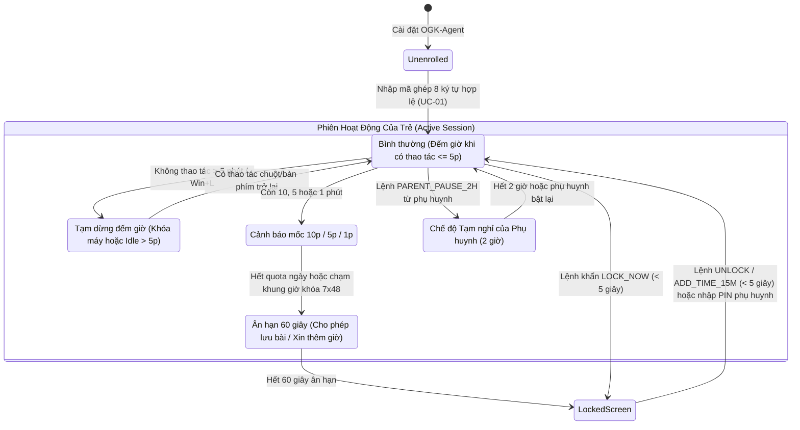

# Đặc Tả Chức Năng Hệ Thống (Functional Specification Document)

> **Tài liệu thuộc bộ đặc tả kiến trúc dự án OGK (Open Guardian for Kids)**
> - [Kiến trúc hệ thống (architecture.md)](./architecture.md)
> - [Đặc tả chức năng (functional-specification.md)](./functional-specification.md) *(Tài liệu hiện tại)*
> - [Đặc tả kỹ thuật (technical-specification.md)](./technical-specification.md)
> - [Đối chiếu tính năng (feature-comparison.md)](./feature-comparison.md)
> - [Nhật ký thay đổi & Truy vết (architecture-change-log.md)](./architecture-change-log.md)

---

## Mục Lục

1. [Phạm Vi Dự Án (Project Scope)](#1-phạm-vi-dự-án-project-scope)
2. [Tác Nhân & Vai Trò Người Dùng (Actors & User Roles)](#2-tác-nhân--vai-trò-người-dùng-actors--user-roles)
3. [Danh Mục Yêu Cầu Chức Năng (Functional Requirements Catalog)](#3-danh-mục-yêu-cầu-chức-năng-functional-requirements-catalog)
4. [Đặc Tả Ca Sử Dụng (Use Cases)](#4-đặc-tả-ca-sử-dụng-use-cases)
5. [Câu Chuyện Người Dùng (User Stories)](#5-câu-chuyện-người-dùng-user-stories)
6. [Luồng Tương Tác Người Dùng & Trạng Thái Giao Diện (User Flows & UI States)](#6-luồng-tương-tác-người-dùng--trạng-thái-giao-diện-user-flows--ui-states)
7. [Đặc Tả Dữ Liệu Đầu Vào / Đầu Ra (Input / Output Specifications)](#7-đặc-tả-dữ-liệu-đầu-vào--đầu-ra-input--output-specifications)
8. [Quy Tắc Nghiệp Vụ (Business Rules)](#8-quy-tắc-nghiệp-vụ-business-rules)
9. [Xử Lý Ngoại Lệ (Exception Handling)](#9-xử-lý-ngoại-lệ-exception-handling)
10. [Tiêu Chí Nghiệm Thu Tổng Hợp (Acceptance Criteria)](#10-tiêu-chí-nghiệm-thu-tổng-hợp-acceptance-criteria)

---

## 1. Phạm Vi Dự Án (Project Scope)

### 1.1. Trong Phạm Vi (In-Scope)
- **Quản lý thời gian sử dụng máy tính của trẻ (F1)**: Hạn mức ngày thường/cuối tuần, lịch tuần ma trận $7 \times 48$ (độ phân giải 30 phút), đếm thời gian hoạt động thực (loại trừ khi khóa máy hoặc không tương tác quá 5 phút), cảnh báo trước 10/5/1 phút kèm 60 giây ân hạn lưu bài, chống chỉnh đồng hồ hệ thống, ngân sách theo nhóm ứng dụng và thưởng giờ.
- **Lọc và kiểm soát ứng dụng / website theo độ tuổi (F2)**: Chặn/cho phép ứng dụng theo tên tiến trình + mã băm SHA-256 + `OriginalFileName` (PE Header); hiển thị hộp thoại giải thích khi chặn; lọc tên miền và tên miền con qua DNS Proxy cục bộ tại `127.0.0.1:53`; hạ tầng phân loại 6 nhóm ($\ge 200$ mục an toàn, chính sách mặc định cho trẻ 6–11 tuổi); cưỡng chế SafeSearch; đối phó DNS-over-HTTPS (DoH) và chống đổi DNS thủ công.
- **Ghi nhận và báo cáo hoạt động minh bạch (F3)**: Tuân thủ lược đồ sự kiện 7 trường (`ts, device_id, child_id, type, subject, duration_sec, policy_id`); Dashboard thống kê cho phụ huynh; màn hình *"Hôm nay em đã dùng gì"* cho trẻ; lưu trữ tối đa 90 ngày; nút *"Xóa toàn bộ dữ liệu của con tôi"*; xuất báo cáo CSV/PDF; gợi ý nghỉ mắt 20-20-20.
- **Quản trị từ xa, vòng đời ghép đôi & kiểm toán (4.3, F4)**: Mô hình `1 phụ huynh : n trẻ : m thiết bị`; ghép đôi bằng mã 8 ký tự (10 phút); đồng bộ chính sách ký số trong $\le 60\text{s}$; lệnh khẩn qua WebSocket trong $< 5\text{s}$; nhật ký kiểm toán (Audit Log) công khai cho trẻ xem; quy trình gỡ cài đặt hợp pháp kèm khôi phục sạch cấu hình mạng/Registry (`ogk_cleanup`).
- **Bảo mật, quyền riêng tư & chống lạm dụng (F5)**: Xác thực Argon2id, khóa tạm khi sai mật khẩu, Cookie an toàn + CSRF, TLS 1.2+ kèm Certificate Pinning, mã hóa AES-GCM (DPAPI/biến môi trường), phân quyền RBAC chống IDOR, không có chế độ ẩn.

### 1.2. Ngoài Phạm Vi (Out-of-Scope — Đã Loại Bỏ Khỏi Ứng Dụng Tham Khảo)
- **Không** chụp ảnh màn hình Desktop của trẻ (`REF-20` — bị từ chối vì xâm phạm quyền riêng tư).
- **Không** cài tiện ích trình duyệt thu thập URL đầy đủ, từ khóa tìm kiếm cá nhân hay nội dung tin nhắn (`REF-19` — bị từ chối vì vi phạm lược đồ F3).
- **Không** đính kèm danh sách tên miền người lớn thực tế vào kho mã nguồn (`REF-21` — bị từ chối theo quy định kiểm thử F2).
- **Không** can thiệp ẩn ổ đĩa cứng, két an toàn sao lưu tệp hay quản lý bản quyền thương mại (`REF-22`).

---

## 2. Tác Nhân & Vai Trò Người Dùng (Actors & User Roles)

| Tác nhân (Actor) | Mã vai trò (RBAC Role) | Mô tả & Quyền hạn |
|---|---|---|
| **Phụ huynh (Parent)** | `parent` | Người giám hộ hợp pháp của trẻ. Đăng ký tài khoản, tạo hồ sơ trẻ, tạo mã ghép đôi thiết bị (đồng thời xác nhận sự đồng ý theo Nghị định 13/2023), cấu hình chính sách thời gian/ứng dụng/website, gửi lệnh khẩn (khóa máy, cộng giờ, tạm nghỉ), phê duyệt yêu cầu xin thêm giờ, xem báo cáo và xóa dữ liệu của con mình (chỉ truy cập dữ liệu thuộc `parent_id` của chính mình). |
| **Trẻ em (Child)** | `child-view` | Người sử dụng máy tính Windows (dưới tài khoản Standard User). Quan sát đồng hồ thời gian còn lại trên `OGK-Tray`, nhận cảnh báo 10/5/1 phút và 60 giây ân hạn, gửi yêu cầu *"Xin thêm giờ"*, xem màn hình minh bạch *"Hôm nay em đã dùng gì"* và xem Nhật ký kiểm toán (Audit Log) các thay đổi chính sách của phụ huynh (chỉ đọc). |
| **Quản trị viên Hệ thống (System Admin)** | `admin` | Quản trị viên vận hành `OGK-Server` (quản lý danh mục phân loại 6 nhóm mặc định $\ge 200$ mục, theo dõi tình trạng hoạt động chung của máy chủ; không can thiệp trái phép vào dữ liệu riêng tư của từng gia đình). |
| **OGK-Agent (Device Agent)** | `device-agent` *(Xác thực bằng Device JWT)* | Dịch vụ Windows (`OGK-Service`) và giao diện khay hệ thống (`OGK-Tray`) chạy trên máy của trẻ. Thực thi chính sách, gửi nhịp tim 60 giây, nhận lệnh WebSocket $< 5\text{s}$ và đồng bộ sự kiện lên Server. |

---

## 3. Danh Mục Yêu Cầu Chức Năng (Functional Requirements Catalog)

Quy ước phân loại nguồn gốc:
- **[Mandatory - Teacher]**: Yêu cầu bắt buộc trong `DoAn01.docx`.
- **[Should/Could - Teacher]**: Yêu cầu NÊN CÓ / CÓ THÌ TỐT trong `DoAn01.docx`.
- **[Adopted/Adapted - Ref]**: Cơ chế kỹ thuật/UX học hỏi hoặc điều chỉnh từ ứng dụng tham khảo `Safe Kids v5.1.27`.

### 3.1. Nhóm Vòng Đời & Giao Thức Hệ Thống (`FR-LC`)

| ID | Tên yêu cầu | Mô tả chi tiết | Mức ưu tiên | Nguồn gốc |
|---|---|---|---|---|
| **FR-LC-01** | Ghép đôi thiết bị (Enrollment) & Ghi nhận sự đồng ý | Phụ huynh tạo mã ghép đôi 8 ký tự (chữ hoa + số) có thời hạn 10 phút trên Dashboard sau khi tích chọn xác nhận đồng ý của cha mẹ (Nghị định 13/2023). Agent gửi mã kèm `device_fingerprint` và `windows_user_sid`; Server trả về `device_id`, `child_id` và cặp token (`access_token` hạn 15 phút, `refresh_token` dài hạn). | **BẮT BUỘC** (`MUST HAVE`) | [Mandatory - Teacher] (4.3) + `REF-15` |
| **FR-LC-02** | Nhịp tim (Heartbeat) 60 giây & Đồng bộ chính sách | Mỗi 60 giây, Agent gửi trạng thái hoạt động, số giây quota đã dùng, thời gian hệ thống hiện tại và `policy_version` đang áp dụng lên Server. Server trả về `server_utc`, `latest_policy_version` và danh sách lệnh chờ. Nếu lệch phiên bản, Agent gọi `GET /api/v1/policy` để tải chính sách mới. | **BẮT BUỘC** (`MUST HAVE`) | [Mandatory - Teacher] (4.3) |
| **FR-LC-03** | Lệnh khẩn thời gian thực qua WebSocket ($< 5\text{s}$) | Agent duy trì kết nối WebSocket (`WSS`) tới Server để nhận và thực thi tức thời trong vòng $< 5\text{ giây}$ các lệnh khẩn từ phụ huynh: **Khóa ngay (`LOCK_NOW`)**, **Mở khóa (`UNLOCK`)**, **Cộng thêm 15 phút (`ADD_TIME_15M`)**. | **BẮT BUỘC** (`MUST HAVE`) | [Mandatory - Teacher] (4.3, F4) |
| **FR-LC-04** | Chế độ ngoại tuyến (Offline Mode) & Đồng bộ lô chống trùng | Khi mất kết nối tới Server, Agent tiếp tục áp dụng chính sách đã ký lưu trong SQLite cục bộ, tiếp tục đếm thời gian và lưu sự kiện vào hàng đợi `event_queue`. Khi có mạng lại, Agent gửi sự kiện theo lô (`POST /api/v1/events/batch`) kèm khóa chống trùng `idempotency_key` (UUIDv4/SHA-256) để không sự kiện nào bị tính hai lần. | **BẮT BUỘC** (`MUST HAVE`) | [Mandatory - Teacher] (4.3) |
| **FR-LC-05** | Xử lý chính sách hết hạn sau $N=7$ ngày mất kết nối | Nếu quá $N = 7\text{ ngày}$ liên tục không kết nối được Server, Agent chuyển sang chế độ **Graded Fail-Open** (ADR-01): vẫn duy trì bộ lọc DNS an toàn và chặn ứng dụng trò chơi/không phù hợp, nhưng không khóa cứng toàn bộ máy tính để trẻ vẫn dùng được các công cụ học tập, đồng thời cảnh báo trạng thái mất kết nối dài ngày. | **BẮT BUỘC** (`MUST HAVE`) | [Mandatory - Teacher] (4.3) |

### 3.2. Nhóm F1 — Quản Lý Thời Gian Sử Dụng (`FR-F1`)

| ID | Tên yêu cầu | Mô tả chi tiết | Mức ưu tiên | Nguồn gốc |
|---|---|---|---|---|
| **FR-F1-01** | Hạn mức thời gian theo ngày (Ngày thường & Cuối tuần) | Cho phép phụ huynh cấu hình hạn mức tổng thời gian sử dụng máy trong ngày (tính bằng phút, ví dụ 90 phút), cấu hình riêng biệt giữa Ngày thường (Thứ 2 – Thứ 6) và Cuối tuần (Thứ 7 – Chủ nhật). Khi hết hạn mức, máy tự động chuyển sang quy trình khóa. | **BẮT BUỘC** (`MUST HAVE`) | [Mandatory - Teacher] (F1) |
| **FR-F1-02** | Lịch tuần cho phép/khóa theo ma trận $7 \times 48$ | Cho phép phụ huynh cấu hình khung giờ được phép hoặc bị khóa trong tuần với độ phân giải 30 phút (ma trận 7 ngày $\times$ 48 ô = 336 khung giờ). Ngoài khung giờ cho phép, máy bị khóa trong vòng $\le 5\text{ giây}$. | **BẮT BUỘC** (`MUST HAVE`) | [Mandatory - Teacher] (F1) |
| **FR-F1-03** | Đếm thời gian sử dụng thực (Active Screen-Time) | Chỉ tính thời gian khi phiên của trẻ đang mở và có tương tác thực tế. Tự động tạm dừng bộ đếm khi màn hình Windows bị khóa (`SessionLock`) hoặc khi không có thao tác bàn phím/chuột liên tục quá **5 phút** (`GetLastInputInfo`). Sai số đếm giờ $\le \pm 30\text{ giây}$ trên mỗi giờ. | **BẮT BUỘC** (`MUST HAVE`) | [Mandatory - Teacher] (F1) |
| **FR-F1-04** | Cảnh báo mốc 10, 5, 1 phút & Khoảng ân hạn 60 giây | Hiển thị thông báo nhắc nhở trẻ tại các mốc còn **10 phút, 5 phút và 1 phút** trước khi hết hạn mức hoặc đến giờ khóa. Khi chạm mốc 0 phút, hiển thị cửa sổ đếm ngược **60 giây ân hạn** (kế thừa UX `ViolationCountdownWindow`) để trẻ lưu bài tập hoặc bấm *"Xin thêm giờ"* trước khi máy thực sự khóa. | **BẮT BUỘC** (`MUST HAVE`) | [Mandatory - Teacher] (F1) + [Adapted - Ref] (`REF-04`) |
| **FR-F1-05** | Chống chỉnh đồng hồ hệ thống (Anti-Clock Tampering) | Sử dụng đồng hồ đơn điệu (`time.monotonic()`) để đếm thời gian phiên, kết hợp lưu `last_wall_clock_utc` cục bộ và đối chiếu `server_utc` mỗi nhịp tim 60 giây. Nếu trẻ lùi đồng hồ hệ thống (ví dụ lùi 3 giờ), hạn mức thời gian còn lại tuyệt đối không được tăng thêm và hệ thống ghi nhận sự kiện bất thường. | **BẮT BUỘC** (`MUST HAVE`) | [Mandatory - Teacher] (F1, M6) + [Adapted - Ref] (`REF-13`) |
| **FR-F1-06** | Ngân sách thời gian theo nhóm ứng dụng | Cho phép cấu hình hạn mức thời gian riêng cho từng nhóm phân loại ứng dụng (ví dụ: nhóm `education` không giới hạn, nhóm `gaming` tối đa 45 phút/ngày). Hai bộ đếm tổng và bộ đếm nhóm hoạt động độc lập, chính xác. | **NÊN CÓ** (`SHOULD HAVE`) | [Should - Teacher] (F1) + [Adapted - Ref] (`REF-05`) |
| **FR-F1-07** | Thưởng giờ khi hoàn thành nhiệm vụ | Phụ huynh có thể giao nhiệm vụ (ví dụ: *"Hoàn thành bài tập Toán (+20 phút)"*) trên Dashboard; khi trẻ báo hoàn thành và phụ huynh bấm xác nhận, hệ thống tự động cộng số phút thưởng vào hạn mức trong ngày hôm đó. | **CÓ THÌ TỐT** (`COULD HAVE`) | [Could - Teacher] (F1) |

### 3.3. Nhóm F2 — Lọc Và Kiểm Soát Ứng Dụng / Website Theo Độ Tuổi (`FR-F2`)

| ID | Tên yêu cầu | Mô tả chi tiết | Mức ưu tiên | Nguồn gốc |
|---|---|---|---|---|
| **FR-F2-01** | Kiểm soát ứng dụng bằng Tên tiến trình + SHA-256 + PE `OriginalFileName` | Đối chiếu các tiến trình đang chạy của trẻ với danh sách Chặn (Blocklist) / Cho phép (Allowlist) dựa trên tên tệp thực thi, **mã băm SHA-256** và trường `OriginalFileName` trong PE Header. Nếu trẻ đổi tên `notepad.exe` thành `game.exe` (hoặc ngược lại), hệ thống vẫn nhận diện chính xác qua SHA-256. | **BẮT BUỘC** (`MUST HAVE`) | [Mandatory - Teacher] (F2) + [Adopted - Ref] (`REF-03`) |
| **FR-F2-02** | Kết thúc tiến trình vi phạm kèm Cửa sổ giải thích | Khi phát hiện ứng dụng bị chặn hoặc vượt quá ngân sách thời gian của nhóm, `App Controller` kết thúc tiến trình (`TerminateProcess`) và lập tức hiển thị cửa sổ thông báo trên `OGK-Tray` nêu rõ tên ứng dụng và lý do bị chặn (tuyệt đối không tắt im lặng). | **BẮT BUỘC** (`MUST HAVE`) | [Mandatory - Teacher] (F2) + [Adapted - Ref] (`REF-04`) |
| **FR-F2-03** | Lọc website qua DNS Proxy cục bộ (`127.0.0.1:53`) & Flush DNS Cache | Vận hành máy chủ DNS Proxy tại `127.0.0.1:53` hỗ trợ chặn theo tên miền chính xác (`example.com`) và toàn bộ tên miền con (`*.example.com`). Khi cập nhật chính sách tên miền, tự động gọi `DnsFlushResolverCache()` (`dnsapi.dll`) để có hiệu lực tức thì. Đạt tỷ lệ chặn $\ge 95\%$ trên bộ 50 tên miền kiểm thử và $0\%$ dương tính giả trên 20 tên miền giáo dục. | **BẮT BUỘC** (`MUST HAVE`) | [Mandatory - Teacher] (F2, M1) + [Adapted - Ref] (`REF-07`) |
| **FR-F2-04** | Hạ tầng phân loại 6 nhóm & Chính sách mặc định 6–11 tuổi | Phân loại tên miền và ứng dụng theo đúng **6 nhóm**: `education` (giáo dục), `entertainment` (giải trí), `social` (mạng xã hội), `gaming` (trò chơi), `inappropriate` (không phù hợp lứa tuổi), `unclassified` (chưa phân loại). Đi kèm cơ sở dữ liệu tối thiểu **200 mục an toàn** và mẫu chính sách mặc định cho trẻ 6–11 tuổi (cho phép `education` & `entertainment` lành mạnh, giới hạn `gaming`, chặn `social` & `inappropriate`). | **BẮT BUỘC** (`MUST HAVE`) | [Mandatory - Teacher] (F2) |
| **FR-F2-05** | Cưỡng chế SafeSearch bằng bản ghi DNS | Tại DNS Proxy `127.0.0.1:53`, tự động ánh xạ các truy vấn tới máy chủ tìm kiếm sang địa chỉ SafeSearch bắt buộc (ví dụ: `www.google.com` $\rightarrow$ `forcesafesearch.google.com`, `www.bing.com` $\rightarrow$ `strict.bing.com`, `duckduckgo.com` $\rightarrow$ `safe.duckduckgo.com`, `www.youtube.com` $\rightarrow$ `restrict.youtube.com`). | **BẮT BUỘC** (`MUST HAVE`) | [Mandatory - Teacher] (F2) |
| **FR-F2-06** | Đối phó DNS-over-HTTPS (DoH) đa lớp kèm Browser Registry Snapshot | (1) Trả `NXDOMAIN` cho tên miền canary `use-application-dns.net`; (2) Chặn phân giải danh sách điểm cuối DoH phổ biến (`dns.google`, `cloudflare-dns.com`, `dns.quad9.net`...); (3) Chụp snapshot Registry và áp chính sách trình duyệt (`DnsOverHttpsMode = "off"`) cho Chrome/Edge/Brave/Cốc Cốc. | **NÊN CÓ** (`SHOULD HAVE`) | [Should - Teacher] (F2, M3) + [Adopted - Ref] (`REF-08`, `REF-09`) |
| **FR-F2-07** | Chặn đổi DNS thủ công kèm Snapshot cấu hình Card mạng | Chụp snapshot cấu hình DNS gốc của card mạng trước khi trỏ về `127.0.0.1`; giám sát và tự động khôi phục lại `127.0.0.1` nếu phát hiện cấu hình DNS bị đổi sang máy chủ ngoài (như `8.8.8.8`), hoặc chuyển hướng truy vấn cổng 53. | **NÊN CÓ** (`SHOULD HAVE`) | [Should - Teacher] (F2, M3) + [Adopted - Ref] (`REF-10`) |
| **FR-F2-08** | Cảm biến phát hiện VPN Adapter & System Proxy | Định kỳ kiểm tra danh sách card mạng ảo (TAP/TUN/WireGuard/WARP) và cấu hình Windows System Proxy để ghi nhận cảnh báo vượt rào phục vụ kiểm soát và báo cáo kỹ thuật M3. | **NÊN CÓ** (`SHOULD HAVE`) | [Should - Teacher] (M3) + [Adopted - Ref] (`REF-09`) |

### 3.4. Nhóm F3 — Ghi Nhận Và Báo Cáo Hoạt Động Minh Bạch (`FR-F3`)

| ID | Tên yêu cầu | Mô tả chi tiết | Mức ưu tiên | Nguồn gốc |
|---|---|---|---|---|
| **FR-F3-01** | Tuân thủ nghiêm ngặt Lược đồ Sự kiện 7 trường (Strict Event Schema) | Mọi sự kiện hoạt động lưu trữ và đồng bộ chỉ gồm đúng các trường: `ts`, `device_id`, `child_id`, `type`, `subject`, `duration_sec`, `policy_id` (kèm `idempotency_key` chống trùng). Trong đó `type` $\in$ `{app_start, app_stop, domain_query, blocked_app, blocked_domain, quota_warning, locked, unlock_request, override_granted}` và `subject` chỉ là **tên ứng dụng** hoặc **tên miền cấp hai (eTLD+1)**, tuyệt đối không lưu URL đầy đủ. | **BẮT BUỘC** (`MUST HAVE`) | [Mandatory - Teacher] (F3) |
| **FR-F3-02** | Dashboard thống kê cho Phụ huynh | Hiển thị trực quan trên trình duyệt máy tính và điện thoại: biểu đồ thời lượng sử dụng theo ngày và theo tuần, Top 10 ứng dụng sử dụng nhiều nhất, Top 10 tên miền truy cập, tổng số lần bị chặn, và danh sách yêu cầu xin thêm giờ/mở khóa của trẻ. | **BẮT BUỘC** (`MUST HAVE`) | [Mandatory - Teacher] (F3) |
| **FR-F3-03** | Màn hình minh bạch cho Trẻ (*"Hôm nay em đã dùng gì"*) | Hiển thị cho trẻ (trên cả `OGK-Tray` và Web Dashboard chế độ `child-view`) cùng bộ dữ liệu hoạt động mà phụ huynh nhìn thấy, trình bày bằng ngôn ngữ đơn giản, thân thiện và biểu tượng minh họa trực quan. | **BẮT BUỘC** (`MUST HAVE`) | [Mandatory - Teacher] (F3) |
| **FR-F3-04** | Giới hạn lưu trữ 90 ngày & Nút *"Xóa toàn bộ dữ liệu của con tôi"* | Tác vụ nền tự động xóa mọi bản ghi sự kiện quá **90 ngày**. Cung cấp nút *"Xóa toàn bộ dữ liệu của con tôi"* trên Dashboard phụ huynh để xóa tức thời toàn bộ lịch sử hoạt động của trẻ trên cả `OGK-Server` lẫn bộ nhớ đệm SQLite của `OGK-Agent`. | **BẮT BUỘC** (`MUST HAVE`) | [Mandatory - Teacher] (F3) |
| **FR-F3-05** | Tài liệu Minh bạch Quyền riêng tư (`PRIVACY.md`) | Cung cấp bảng đối chiếu đầy đủ từng trường dữ liệu $\leftrightarrow$ mục đích thu thập $\leftrightarrow$ thời hạn lưu trữ $\leftrightarrow$ người được quyền xem, kèm một phiên bản viết riêng bằng ngôn ngữ dễ hiểu dành cho trẻ em. | **BẮT BUỘC** (`MUST HAVE`) | [Mandatory - Teacher] (F3, 8) |
| **FR-F3-06** | Xuất báo cáo tuần ra CSV / PDF | Cho phép phụ huynh tải xuống báo cáo tổng hợp hoạt động trong tuần của trẻ dưới định dạng tệp CSV hoặc PDF. | **NÊN CÓ** (`SHOULD HAVE`) | [Should - Teacher] (F3) |
| **FR-F3-07** | Gợi ý *"Thời gian nghỉ mắt"* theo quy tắc 20-20-20 | Sau mỗi 20 phút trẻ sử dụng máy liên tục, `OGK-Tray` hiển thị thẻ nhắc nhở nhẹ nhàng khuyến khích trẻ nhìn xa 20 feet (6 mét) trong 20 giây để bảo vệ thị lực. | **CÓ THÌ TỐT** (`COULD HAVE`) | [Could - Teacher] (F3) |

### 3.5. Nhóm F4 — Agent, Bảng Điều Khiển Và Cấu Hình Từ Xa (`FR-F4`)

| ID | Tên yêu cầu | Mô tả chi tiết | Mức ưu tiên | Nguồn gốc |
|---|---|---|---|---|
| **FR-F4-01** | Mô hình đa hồ sơ `1 Phụ huynh : n Trẻ : m Thiết bị` | Hỗ trợ một tài khoản phụ huynh quản lý nhiều hồ sơ trẻ em (`n` trẻ), và mỗi trẻ có thể được gán trên một hoặc nhiều thiết bị máy tính (`m` thiết bị), kèm ánh xạ `windows_user_sid` trên máy dùng chung. | **BẮT BUỘC** (`MUST HAVE`) | [Mandatory - Teacher] (F4) + [Adapted - Ref] (`REF-15`) |
| **FR-F4-02** | Cam kết độ trễ áp dụng Chính sách ($\le 60\text{s}$) & Lệnh khẩn ($< 5\text{s}$) | Mọi thay đổi chính sách trên Dashboard có hiệu lực trên máy trẻ tối đa trong vòng **60 giây** (hoặc ngay lập tức nếu WebSocket đang mở); các lệnh khẩn (khóa ngay, mở khóa, cộng 15 phút) có hiệu lực trong vòng **$< 5\text{ giây}$**. | **BẮT BUỘC** (`MUST HAVE`) | [Mandatory - Teacher] (F4) |
| **FR-F4-03** | Đánh số phiên bản & Ký toàn vẹn Chính sách (`HMAC-SHA256` / `RSA`) | Mỗi bản cập nhật chính sách được tăng số `policy_version` và đính kèm mã xác thực toàn vẹn (HMAC-SHA256 hoặc chữ ký số RSA/Ed25519). `OGK-Agent` bắt buộc xác minh chữ ký trước khi lưu và thực thi; từ chối ngay nếu phát hiện chính sách bị sửa đổi. | **BẮT BUỘC** (`MUST HAVE`) | [Mandatory - Teacher] (F4) + [Adopted - Ref] (`REF-06`) |
| **FR-F4-04** | Nhật ký Kiểm toán (Audit Log) công khai cho Trẻ (Nguyên tắc NT5) | Ghi nhận mọi thay đổi cấu hình và lệnh điều khiển: **ai thực hiện**, **lúc nào (UTC)**, **từ địa chỉ IP nào**, **giá trị cũ** và **giá trị mới**. Trẻ được quyền xem đầy đủ nhật ký kiểm toán này trên màn hình minh bạch. | **BẮT BUỘC** (`MUST HAVE`) | [Mandatory - Teacher] (F4) |
| **FR-F4-05** | Quy trình Gỡ cài đặt Hợp pháp & Công cụ Khôi phục Sạch (`ogk_cleanup`) | Muốn gỡ cài đặt `OGK-Agent` trên máy trẻ, người thực hiện phải nhập đúng mật khẩu/mã xác thực phụ huynh. Hệ thống ghi sự kiện gỡ cài đặt lên Server, sau đó tự động chạy quy trình `ogk_cleanup` hoàn trả cấu hình DNS gốc, xóa Registry trình duyệt từ Snapshot và gỡ Service. | **NÊN CÓ** (`SHOULD HAVE`) | [Should - Teacher] (F4) + [Adopted - Ref] (`REF-11`) |
| **FR-F4-06** | Chế độ *"Tạm nghỉ của phụ huynh"* (2 giờ, có ghi log) | Phụ huynh có thể bật chế độ tạm dừng toàn bộ việc đếm giờ và chặn ứng dụng trong **2 giờ** (ví dụ khi phụ huynh mượn máy trẻ làm việc hoặc cho phép dịp đặc biệt). Hết 2 giờ hệ thống tự động bật lại bảo vệ; thao tác được ghi rõ vào Audit Log. | **CÓ THÌ TỐT** (`COULD HAVE`) | [Could - Teacher] (F4) + [Adapted - Ref] (`REF-12`) |

### 3.6. Nhóm F5 — Bảo Mật, Quyền Riêng Tư & Chống Lạm Dụng (`FR-F5`)

| ID | Tên yêu cầu | Mô tả chi tiết | Mức ưu tiên | Nguồn gốc |
|---|---|---|---|---|
| **FR-F5-01** | Xác thực Phụ huynh An toàn (Argon2id + Lockout + Rate Limit) | Mật khẩu phụ huynh dài tối thiểu 10 ký tự, băm bằng **Argon2id** (hoặc `scrypt` qua `passlib`); tự động khóa tạm **15 phút** sau **5 lần** đăng nhập sai liên tiếp; giới hạn tần suất request theo địa chỉ IP. (Hỗ trợ thêm TOTP 2FA là điểm cộng). | **BẮT BUỘC** (`MUST HAVE`) | [Mandatory - Teacher] (F5) + [Adapted - Ref] (`REF-14`) |
| **FR-F5-02** | Quản lý Phiên & Chống CSRF | Cookie phiên làm việc thiết lập đầy đủ cờ `HttpOnly`, `Secure`, `SameSite=Lax`, thời hạn tối đa **12 giờ**; khi đăng xuất phải hủy phiên trên Server; mọi thao tác ghi (`POST/PUT/PATCH/DELETE`) trên Dashboard bắt buộc kiểm tra CSRF Token. | **BẮT BUỘC** (`MUST HAVE`) | [Mandatory - Teacher] (F5) |
| **FR-F5-03** | Kênh truyền TLS 1.2+ & Ghim chứng chỉ (Certificate Pinning) | Toàn bộ giao tiếp giữa Agent, Dashboard và Server chạy trên HTTPS/WSS (TLS 1.2+). `OGK-Agent` ghim chứng chỉ số của Server/CA phòng lab và từ chối kết nối ngay nếu chứng chỉ không khớp. | **BẮT BUỘC** (`MUST HAVE`) | [Mandatory - Teacher] (F5) |
| **FR-F5-04** | Định danh Thiết bị bằng Access Token (15p) + Refresh Token & Thu hồi | Sử dụng `access_token` ngắn hạn (15 phút) kèm `refresh_token` gắn chặt với `device_id`; kiểm tra danh sách thu hồi (Revocation List) để vô hiệu hóa ngay khi phụ huynh gỡ thiết bị khỏi Dashboard. | **BẮT BUỘC** (`MUST HAVE`) | [Mandatory - Teacher] (F5) |
| **FR-F5-05** | Mã hóa Lưu trữ AES-GCM (Khóa từ Biến môi trường / DPAPI) | Các trường nhạy cảm trong CSDL và cấu hình cục bộ được mã hóa bằng **AES-256-GCM**; khóa giải mã lấy từ biến môi trường (trên Server) hoặc **Windows DPAPI** (trên Agent), tuyệt đối không hardcode trong mã nguồn; băm bí mật thiết bị. | **BẮT BUỘC** (`MUST HAVE`) | [Mandatory - Teacher] (F5) |
| **FR-F5-06** | Phân quyền 3 Vai trò (`parent`, `child-view`, `admin`) & Chống IDOR | Kiểm tra quyền sở hữu tài nguyên (`parent_id == current_user.id`) trực tiếp ở tầng truy vấn cơ sở dữ liệu cho mọi API, không chỉ ẩn nút trên giao diện. | **BẮT BUỘC** (`MUST HAVE`) | [Mandatory - Teacher] (F5) |
| **FR-F5-07** | Đặc quyền Cục bộ, Bảo vệ ACL `ProgramData` & Bảo mật IPC | Tài khoản Windows của trẻ là Standard User; thư mục dữ liệu `C:\ProgramData\OGK` được gán NTFS ACL chỉ cho phép `SYSTEM` và `Administrators` quyền ghi; giao tiếp IPC giữa Tray UI và Service dùng `IpcEnvelope` có kiểm tra `CallerSid` và `hmac.compare_digest`. | **BẮT BUỘC** (`MUST HAVE`) | [Mandatory - Teacher] (4.2, F5) + [Adopted - Ref] (`REF-02`) |
| **FR-F5-08** | Mô hình Mối đe dọa STRIDE (`THREATMODEL.md`) | Xây dựng bảng phân tích STRIDE tối thiểu **8 mối đe dọa**, bắt buộc bao gồm kịch bản *"Chính trẻ là người tấn công"* và kịch bản *"Sản phẩm bị lạm dụng để theo dõi người lớn (Stalkerware)"*. | **BẮT BUỘC** (`MUST HAVE`) | [Mandatory - Teacher] (F5, 8) |
| **FR-F5-09** | Chống Lạm dụng & Cấm Chế độ Ẩn (No Stealth Mode) | Sản phẩm tuyệt đối không có chế độ chạy ẩn. `SessionAgentLauncher` luôn đảm bảo biểu tượng `OGK-Tray` hiển thị rõ ràng trên màn hình của trẻ; nếu không thể hiển thị biểu tượng sau các lần thử phục hồi, `OGK-Service` tự động dừng cưỡng chế. | **BẮT BUỘC** (`MUST HAVE`) | [Mandatory - Teacher] (F5) + [Adopted - Ref] (`REF-01`) |

---

## 4. Đặc Tả Ca Sử Dụng (Use Cases)

### UC-01: Ghép đôi Thiết bị Mới và Ghi nhận Đồng ý của Phụ huynh (`FR-LC-01`)
- **Tác nhân chính**: Phụ huynh (`parent`), `OGK-Agent`.
- **Điều kiện tiên quyết**: Phụ huynh đã đăng nhập Dashboard và tạo hồ sơ trẻ (ví dụ: *"Bé An - 9 tuổi"*); `OGK-Agent` vừa được cài đặt trên máy Windows của trẻ.
- **Luồng sự kiện chính**:
  1. Trên Dashboard, phụ huynh chọn hồ sơ *"Bé An"*, bấm **"Thêm thiết bị mới"**.
  2. Hệ thống hiển thị thông báo giải thích phạm vi dữ liệu thu thập theo Nghị định 13/2023 và nguyên tắc minh bạch với trẻ. Phụ huynh tích xác nhận đồng ý và bấm **"Tạo mã ghép đôi"**.
  3. `OGK-Server` sinh mã ghép đôi 8 ký tự (ví dụ: `K9M4P2X7`), lưu hạn sử dụng 10 phút và ghi vào Audit Log.
  4. Trên máy tính của trẻ, phụ huynh mở hộp thoại ghép đôi của `OGK-Agent`, nhập địa chỉ máy chủ, nhập mã `K9M4P2X7` và chọn tài khoản Windows của trẻ (`Standard User`).
  5. `OGK-Agent` gửi `POST /api/v1/enroll` kèm mã ghép, `device_fingerprint` và `windows_user_sid`.
  6. `OGK-Server` xác thực mã hợp lệ, tạo bản ghi `Device`, trả về `device_id`, `access_token`, `refresh_token` và bản chính sách mặc định cho độ tuổi 6–11 đã ký số.
  7. `OGK-Agent` lưu token (bảo vệ bằng DPAPI), áp dụng chính sách và hiển thị biểu tượng `OGK-Tray`.

### UC-02: Đếm Giờ Thực, Cảnh Báo 10/5/1 Phút, Ân Hạn 60 Giây và Xin Thêm Giờ (`FR-F1-01` $\rightarrow$ `FR-F1-04`, `FR-LC-03`)
- **Tác nhân chính**: Trẻ em (`child-view`), Phụ huynh (`parent`), `OGK-Agent`.
- **Luồng sự kiện chính**:
  1. Trẻ đăng nhập Windows và sử dụng máy tính. `OGK-Service` đếm thời gian hoạt động thực bằng `time.monotonic()`.
  2. Khi trẻ rời máy quá 5 phút hoặc khóa màn hình (`Win + L`), bộ đếm tự động tạm dừng.
  3. Khi thời gian còn lại chạm các mốc **10 phút**, **5 phút** và **1 phút**, `OGK-Service` ghi sự kiện `quota_warning` và gửi tín hiệu qua Named Pipe để `OGK-Tray` hiển thị thông báo nhắc nhở.
  4. Khi thời gian còn lại về **0 phút**, `OGK-Tray` hiển thị cửa sổ **Đếm ngược ân hạn 60 giây** (*"Em còn 60 giây để lưu bài tập"*).
  5. Trẻ bấm nút **"Xin thêm giờ (+15 phút)"** và chọn lý do (*"Em đang làm nốt bài tập trên lớp"*).
  6. `OGK-Agent` gửi sự kiện `unlock_request` và tạo yêu cầu trên `OGK-Server`.
  7. Nếu hết 60 giây mà phụ huynh chưa duyệt, máy chuyển sang trạng thái khóa (`locked`), hiển thị màn hình chờ phê duyệt.
  8. Phụ huynh mở Dashboard trên điện thoại, thấy yêu cầu của con và bấm **"Duyệt (+15 phút)"**.
  9. `OGK-Server` ghi sự kiện `override_granted`, ghi Audit Log và đẩy lệnh `ADD_TIME_15M` qua WebSocket xuống Agent.
  10. Trong vòng $< 5\text{ giây}$, `OGK-Agent` cộng 15 phút và mở khóa màn hình cho trẻ tiếp tục làm bài.

### UC-03: Nhận Diện & Chặn Ứng Dụng Bị Đổi Tên Bằng SHA-256 (`FR-F2-01`, `FR-F2-02`)
- **Tác nhân chính**: Trẻ em, `OGK-Agent` (`App Controller`).
- **Luồng sự kiện chính**:
  1. Phụ huynh đưa ứng dụng `notepad.exe` (hoặc một trò chơi) vào danh sách chặn; chính sách chứa cả tên tệp lẫn mã băm SHA-256 của tệp thực thi.
  2. Trẻ sao chép tệp thực thi ra màn hình Desktop và đổi tên thành `hoc_toan.exe` rồi khởi chạy.
  3. `App Controller` phát hiện tiến trình mới `hoc_toan.exe`, tính mã băm SHA-256 và đọc `OriginalFileName` trong PE Header.
  4. Phát hiện mã băm SHA-256 trùng khớp với ứng dụng bị chặn trong chính sách, `App Controller` gọi `TerminateProcess` để đóng tiến trình ngay lập tức.
  5. `OGK-Agent` ghi sự kiện `blocked_app` (`subject = "notepad.exe"`) và hiển thị cửa sổ giải thích trên `OGK-Tray`: *"Ứng dụng hoc_toan.exe (Nhận diện gốc: notepad.exe) đã bị tạm dừng theo quy tắc của phụ huynh."*

### UC-04: Lọc Tên Miền, Cưỡng Chế SafeSearch & Chống DoH Qua DNS Proxy (`FR-F2-03` $\rightarrow$ `FR-F2-06`)
- **Tác nhân chính**: Trẻ em, `OGK-Agent` (`DNS Proxy`).
- **Luồng sự kiện chính**:
  1. Khi khởi động, `OGK-Service` chụp snapshot cấu hình DNS gốc của card mạng và Registry trình duyệt, sau đó trỏ DNS card mạng về `127.0.0.1` và đặt `DnsOverHttpsMode = "off"` trên trình duyệt.
  2. Trẻ mở trình duyệt truy cập `sub.blocked-test.example`.
  3. Truy vấn DNS đi tới `127.0.0.1:53`. `DomainPolicyEngine` khớp quy tắc wildcard `*.blocked-test.example`, trả về `0.0.0.0` / `NXDOMAIN` và ghi sự kiện `blocked_domain` (`subject = "blocked-test.example"`).
  4. Trẻ truy cập `www.google.com` để tìm kiếm. DNS Proxy trả về bản ghi CNAME/IP của `forcesafesearch.google.com`, ép trình duyệt bật chế độ lọc kết quả an toàn và ghi sự kiện `domain_query` (`subject = "google.com"`).

### UC-05: Xem Màn Hình Minh Bạch, Kiểm Toán (NT5) & Xóa Toàn Bộ Dữ Liệu (`FR-F3-03`, `FR-F3-04`, `FR-F4-04`)
- **Tác nhân chính**: Trẻ em (`child-view`), Phụ huynh (`parent`).
- **Luồng sự kiện chính**:
  1. Trẻ bấm nút **"Hôm nay em đã dùng gì"** trên `OGK-Tray`. Giao diện hiển thị biểu đồ thời gian học tập/giải trí trong ngày, danh sách ứng dụng và tên miền đã dùng, cùng tab **"Lịch sử thay đổi của bố mẹ"** (Audit Log hiển thị rõ thời điểm phụ huynh thay đổi hạn mức).
  2. Khi phụ huynh muốn xóa lịch sử của con, phụ huynh bấm nút **"Xóa toàn bộ dữ liệu của con tôi"** trên Dashboard và xác nhận mật khẩu.
  3. `OGK-Server` xóa toàn bộ bản ghi sự kiện của `child_id` trong CSDL Server, ghi nhận thao tác vào Audit Log và gửi lệnh `PURGE_DATA` qua WebSocket xuống `OGK-Agent` để xóa đồng thời các bản ghi trong SQLite cục bộ.

### UC-06: Gỡ Cài Đặt Hợp Pháp & Khôi Phục Sạch Hệ Thống (`FR-F4-05`)
- **Tác nhân chính**: Phụ huynh, `OGK-Cleanup`.
- **Luồng sự kiện chính**:
  1. Phụ huynh chạy lệnh gỡ cài đặt `OGK-Agent` trên máy trẻ và nhập mật khẩu phụ huynh.
  2. `OGK-Service` xác thực mật khẩu (qua Server hoặc mã băm Argon2id lưu trong chính sách cục bộ), gửi sự kiện gỡ cài đặt lên Server.
  3. Mô-đun `ogk_cleanup` đọc bảng `system_snapshots`, khôi phục cấu hình DNS card mạng về nguyên trạng (DHCP hoặc IP tĩnh ban đầu), khôi phục Registry của Chrome/Edge/Cốc Cốc, gọi `DnsFlushResolverCache()` và gỡ bỏ Windows Service sạch sẽ.

---

## 5. Câu Chuyện Người Dùng (User Stories)

| ID | Vai trò | Mong muốn (As a... I want to...) | Mục đích / Giá trị (...so that...) | Yêu cầu liên kết |
|---|---|---|---|---|
| **US-01** | Phụ huynh | Ghép đôi máy tính của con bằng mã 8 ký tự trên điện thoại | Không phải cấu hình kỹ thuật phức tạp và ghi nhận rõ sự đồng ý của phụ huynh. | `FR-LC-01` |
| **US-02** | Phụ huynh | Thiết lập hạn mức ngày thường (ví dụ 60 phút) khác với cuối tuần (120 phút) và ma trận lịch tuần $7 \times 48$ | Con tập trung học và ngủ đúng giờ trong tuần nhưng vẫn có thời gian giải trí cuối tuần. | `FR-F1-01`, `FR-F1-02` |
| **US-03** | Trẻ em | Nhận được thông báo trước 10, 5, 1 phút và có 60 giây ân hạn trước khi máy khóa | Em kịp lưu lại bài tập đang làm mà không bị mất dữ liệu đột ngột. | `FR-F1-04` |
| **US-04** | Trẻ em | Bấm nút "Xin thêm giờ" ngay trên màn hình thông báo | Em có thể gửi lời nhắn xin bố mẹ thêm 15 phút khi đang làm bài kiểm tra trực tuyến. | `FR-LC-03`, `FR-F1-04` |
| **US-05** | Phụ huynh | Khóa máy ngay lập tức hoặc cộng thêm 15 phút từ trình duyệt điện thoại trong $< 5\text{ giây}$ | Phản hồi kịp thời nhu cầu của con dù đang ở cơ quan. | `FR-LC-03`, `FR-F4-02` |
| **US-06** | Phụ huynh | Đặt ngân sách riêng cho nhóm Học tập (không giới hạn) và Trò chơi (45 phút) | Khuyến khích con tra cứu tài liệu học tập mà vẫn kiểm soát được thời gian chơi game. | `FR-F1-06` |
| **US-07** | Phụ huynh | Chặn ứng dụng dựa trên cả mã băm SHA-256 | Con không thể lách luật bằng cách đổi tên tệp thực thi của trò chơi. | `FR-F2-01` |
| **US-08** | Trẻ em | Nhìn thấy cửa sổ giải thích lý do rõ ràng mỗi khi một ứng dụng hoặc trang web bị chặn | Em hiểu quy tắc gia đình thay vì nghĩ máy tính bị hỏng. | `FR-F2-02` |
| **US-09** | Phụ huynh | Bật chính sách lọc web mặc định cho lứa tuổi 6–11 và cưỡng chế SafeSearch | Bảo vệ con khỏi các kết quả tìm kiếm và tên miền không phù hợp lứa tuổi. | `FR-F2-04`, `FR-F2-05` |
| **US-10** | Trẻ em | Xem màn hình *"Hôm nay em đã dùng gì"* và lịch sử thay đổi quy tắc của bố mẹ | Em tự rèn luyện thói quen quản lý thời gian trong môi trường tôn trọng và minh bạch. | `FR-F3-03`, `FR-F4-04` |
| **US-11** | Phụ huynh | Xóa toàn bộ dữ liệu hoạt động của con chỉ bằng một nút bấm | Bảo vệ tuyệt đối quyền riêng tư của con khi không còn nhu cầu lưu trữ. | `FR-F3-04` |
| **US-12** | Phụ huynh | Gỡ cài đặt phần mềm bằng mật khẩu của mình và máy tính tự khôi phục mạng nguyên trạng | Trẻ không tự ý gỡ được phần mềm, nhưng khi phụ huynh gỡ thì máy tính hoạt động bình thường 100%. | `FR-F4-05` |

---

## 6. Luồng Tương Tác Người Dùng & Trạng Thái Giao Diện (User Flows & UI States)

---

## 7. Đặc Tả Dữ Liệu Đầu Vào / Đầu Ra (Input / Output Specifications)

| Chức năng | Dữ liệu Đầu vào (Inputs & Validation) | Dữ liệu Đầu ra (Outputs & Side Effects) |
|---|---|---|
| **Đăng ký / Đăng nhập Phụ huynh** | - `email`: Định dạng email hợp lệ. - `password`: Chuỗi $\ge 10$ ký tự. - `csrf_token`: Khớp phiên hiện tại. | - Cookie `ogk_session` (`HttpOnly, Secure, SameSite=Lax`, TTL 12h). - Nếu sai 5 lần: HTTP `429/423` + khóa tài khoản 15 phút. |
| **Ghép đôi Thiết bị (`/enroll`)** | - `pairing_code`: 8 ký tự `[A-Z0-9]`, chưa hết hạn 10 phút. - `device_fingerprint`: SHA-256 của MachineGUID + Hostname. - `windows_user_sid`: Định dạng `S-1-5-21-...` | - JSON: `{device_id, child_id, access_token, refresh_token, policy}`. - Bản ghi Audit Log xác nhận sự đồng ý của phụ huynh. |
| **Cấu hình Chính sách (`/policy`)** | - `daily_limit_weekday_min`, `daily_limit_weekend_min`: Số nguyên $0 \dots 1440$. - `schedule_matrix_7x48`: Mảng $7 \times 48$ giá trị boolean (`0`/`1`). - `app_rules`: Danh sách `{exe_name, sha256, original_filename, category, action}`. - `domain_rules`: Danh sách `{domain, category, action}`. | - Bản ghi Policy mới với `version = old_version + 1` và chữ ký `signature` (`HMAC-SHA256`). - Đẩy thông báo qua WebSocket tới Agent; tạo bản ghi Audit Log (lưu cả `old_value` và `new_value`). |
| **Gửi Sự kiện Hoạt động (`/events/batch`)** | Danh sách tối đa 200 sự kiện/lô, mỗi sự kiện bắt buộc khớp đúng lược đồ: `{idempotency_key, ts, device_id, child_id, type, subject, duration_sec, policy_id}`. *(Từ chối bằng HTTP `422` nếu `subject` chứa đường dẫn `/` hoặc query `?` của URL đầy đủ).* | - JSON: `{accepted_count, duplicate_count, acked_keys}`. - Cập nhật thống kê ngày/tuần trên Dashboard. |

---

## 8. Quy Tắc Nghiệp Vụ (Business Rules)

- **BR-01 (Quy tắc Tính giờ thực)**: Thời gian sử dụng chỉ được cộng dồn khi phiên Windows của trẻ ở trạng thái `Active` và thời gian nhàn rỗi (`Idle Time` từ lần gõ phím/di chuột cuối) $\le 300\text{ giây}$ (5 phút).
- **BR-02 (Quy tắc Ưu tiên Khóa máy)**: Máy tính của trẻ bị khóa khi **MỘT TRONG BA** điều kiện xảy ra: (a) Ô hiện tại trong ma trận lịch tuần $7 \times 48$ có giá trị `0` (Khóa); (b) Tổng thời gian sử dụng trong ngày đạt hạn mức (`daily_limit`); hoặc (c) Nhận lệnh `LOCK_NOW` từ phụ huynh.
- **BR-03 (Quy tắc Ân hạn 60 giây)**: Khi khóa máy do hết hạn mức ngày hoặc chạm khung giờ khóa định kỳ, hệ thống luôn cấp đúng **60 giây ân hạn** để trẻ lưu tài liệu. Riêng lệnh khẩn `LOCK_NOW` từ phụ huynh sẽ khóa trong vòng $< 5\text{ giây}$.
- **BR-04 (Quy tắc Chống chỉnh giờ)**: Thời lượng đã dùng trong ngày chỉ tăng đơn điệu theo `time.monotonic()`. Việc thay đổi đồng hồ hệ thống của Windows về quá khứ hoặc tương lai không được phép làm tăng số phút còn lại của trẻ.
- **BR-05 (Quy tắc Nhận diện Ứng dụng)**: Một tiến trình bị coi là khớp với quy tắc ứng dụng nếu trùng khớp **mã băm SHA-256** HOẶC trùng khớp `OriginalFileName` / `exe_name`. Danh sách Cho phép (Allowlist) của các tiến trình hệ thống thiết yếu (`explorer.exe`, `svchost.exe`, `ogk_tray.exe`) luôn được bảo vệ để không bao giờ khóa nhầm hệ điều hành.
- **BR-06 (Quy tắc Khớp Tên miền DNS)**: Quy tắc chặn một tên miền gốc `example.com` tự động áp dụng cho cả `example.com` và mọi tên miền con `*.example.com` ở bất kỳ cấp độ nào (`a.b.example.com`). Quy tắc Cho phép cụ thể (Allowlist) có độ ưu tiên cao hơn quy tắc chặn theo nhóm danh mục.
- **BR-07 (Quy tắc Chuẩn hóa `subject` trong Sự kiện F3)**: Trước khi ghi bất kỳ sự kiện `domain_query` hoặc `blocked_domain` nào vào cơ sở dữ liệu, hệ thống bắt buộc cắt bỏ tên miền con thứ cấp và chỉ giữ lại **tên miền cấp hai đăng ký (Registered Domain / eTLD+1)** (ví dụ `m.youtube.com` $\rightarrow$ `youtube.com`, `sub.school.edu.vn` $\rightarrow$ `school.edu.vn`).
- **BR-08 (Quy tắc Chống Lạm dụng & Cấm Ẩn)**: `OGK-Service` chỉ được phép thực thi chặn ứng dụng và khóa màn hình khi tiến trình `OGK-Tray` đang hoạt động và hiển thị biểu tượng minh bạch trong phiên của trẻ (F5).

---

## 9. Xử Lý Ngoại Lệ (Exception Handling)

| Mã ngoại lệ | Tình huống lỗi / Ngoại lệ | Hành vi xử lý của hệ thống |
|---|---|---|
| **EX-01** | **Cổng `127.0.0.1:53` bị chiếm dụng** (ví dụ do dịch vụ khác trên máy). | `OGK-Service` kiểm tra xung đột khi khởi động, ghi log chi tiết tiến trình đang chiếm cổng 53, thông báo rõ trên `OGK-Tray` và **không** chuyển DNS card mạng về `127.0.0.1` cho đến khi cổng 53 sẵn sàng (tránh làm máy mất mạng). |
| **EX-02** | **Upstream DNS (`1.1.1.1`) không phản hồi (Timeout $> 2\text{s}$)**. | `DNS Proxy` tự động chuyển đổi dự phòng (Failover) sang Upstream DNS thứ cấp (`8.8.8.8` hoặc DNS gốc của router lưu trong Snapshot). |
| **EX-03** | **Chữ ký chính sách (`signature`) không hợp lệ khi tải từ Server hoặc đọc từ đĩa**. | `PolicyVerifier` từ chối nạp chính sách bị hỏng/sửa đổi, giữ nguyên chính sách hợp lệ gần nhất trong bộ nhớ, và gửi cảnh báo bảo mật lên Server ở nhịp tim tiếp theo. |
| **EX-04** | **Trẻ cố tình đóng `OGK-Tray` bằng Task Manager**. | `SessionAgentLauncher` trong `OGK-Service` phát hiện tiến trình tắt sau $\le 3\text{ giây}$ và tự động khởi chạy lại `OGK-Tray` trong phiên của trẻ. |
| **EX-05** | **Mất điện đột ngột khi DNS card mạng đang trỏ về `127.0.0.1`**. | Khi máy khởi động lại, `OGK-Service` (đặt chế độ `Automatic` startup) tự động chạy lại DNS Proxy; nếu người dùng chạy `ogk_cleanup.py`, công cụ đọc `system_snapshots` trong SQLite (chế độ WAL chống hỏng tệp) để khôi phục DNS gốc về DHCP. |

---

## 10. Tiêu Chí Nghiệm Thu Tổng Hợp (Acceptance Criteria)

1. **Nghiệm thu Thời gian (F1)**: Đặt quota 3 phút $\rightarrow$ hệ thống phát cảnh báo mốc 1 phút, đếm ngược 60 giây ân hạn và khóa đúng hạn; ngoài khung giờ trong ma trận $7 \times 48$, máy khóa trong $\le 5\text{ giây}$; khóa màn hình hoặc không thao tác $> 5\text{ phút}$ thì bộ đếm dừng (sai số $\le \pm 30\text{s/giờ}$); lùi đồng hồ Windows 3 giờ không làm tăng quota và sự kiện bị ghi nhận.
2. **Nghiệm thu Kiểm soát Ứng dụng & Web (F2)**: Đổi tên `notepad.exe` thành `game.exe` vẫn bị chặn đúng qua SHA-256 và hiện cửa sổ giải thích lý do; DNS Proxy tại `127.0.0.1:53` chặn $\ge 95\%$ trên bộ 50 tên miền kiểm thử an toàn và $0\%$ dương tính giả trên 20 tên miền giáo dục; kiểm chứng `nslookup www.google.com 127.0.0.1` trả về bản ghi SafeSearch; nộp kèm bảng phân loại 6 nhóm $\ge 200$ mục.
3. **Nghiệm thu Minh bạch & Quyền riêng tư (F3)**: Kiểm tra bảng `events` trong SQLite chỉ có đúng 7 trường nghiệp vụ chuẩn, `subject` không chứa URL đầy đủ; nút *"Xóa toàn bộ dữ liệu của con tôi"* xóa sạch dữ liệu trên cả Server và Agent; có màn hình *"Hôm nay em đã dùng gì"* cho trẻ và tệp `PRIVACY.md` đầy đủ.
4. **Nghiệm thu Điều khiển Từ xa & Kiểm toán (F4)**: Thay đổi chính sách có hiệu lực $\le 60\text{ giây}$; lệnh khóa ngay / cộng 15 phút qua WebSocket có hiệu lực $< 5\text{ giây}$; sửa 1 byte trong tệp chính sách khiến Agent từ chối áp dụng do sai chữ ký; mọi thay đổi đều xuất hiện trong Audit Log mà trẻ xem được.
5. **Nghiệm thu Bảo mật (F5)**: Đăng nhập sai 5 lần bị khóa 15 phút; mật khẩu lưu dạng Argon2id; kiểm thử truy cập chéo `child_id` của phụ huynh khác trả về `403/404` (chống IDOR); thư mục `C:\ProgramData\OGK` từ chối quyền ghi của tài khoản Standard User; đầy đủ bảng STRIDE $\ge 8$ mối đe dọa trong `THREATMODEL.md`.
